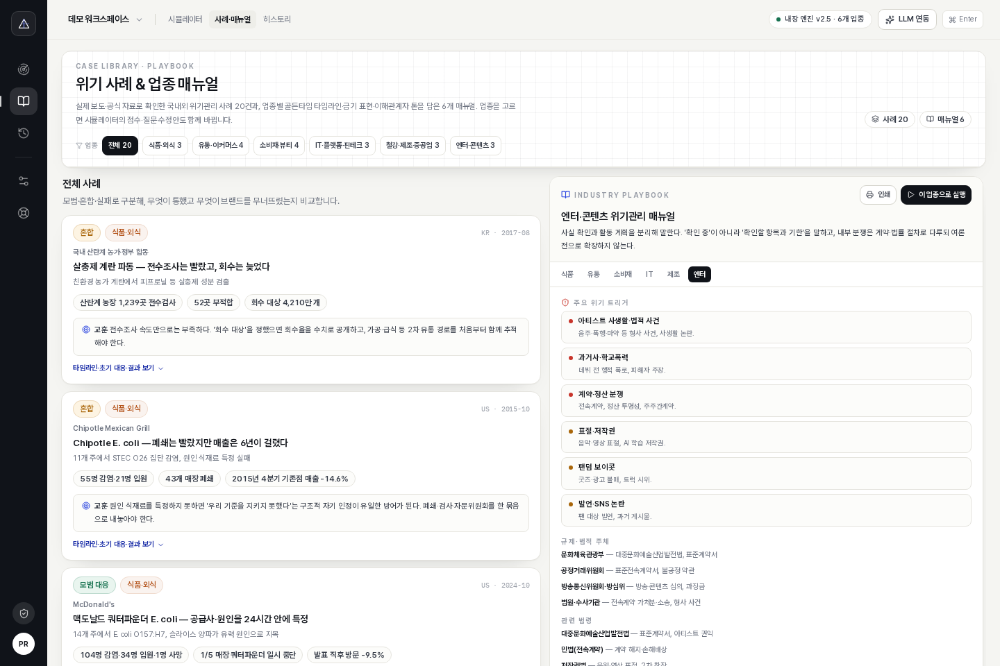
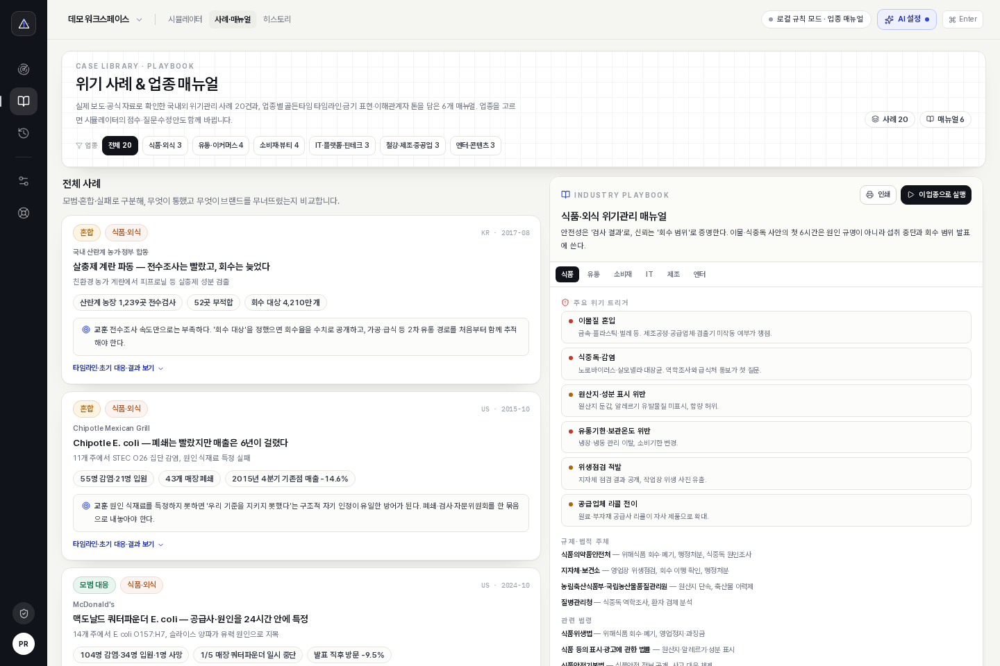
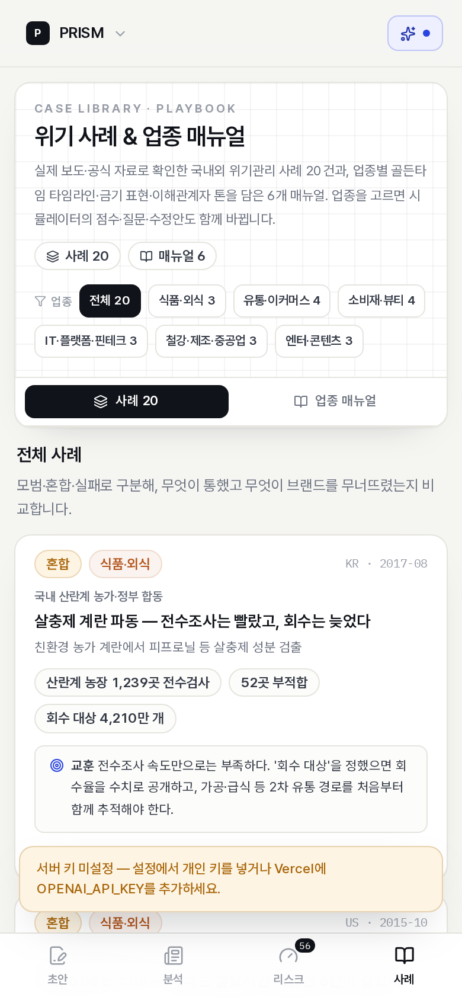
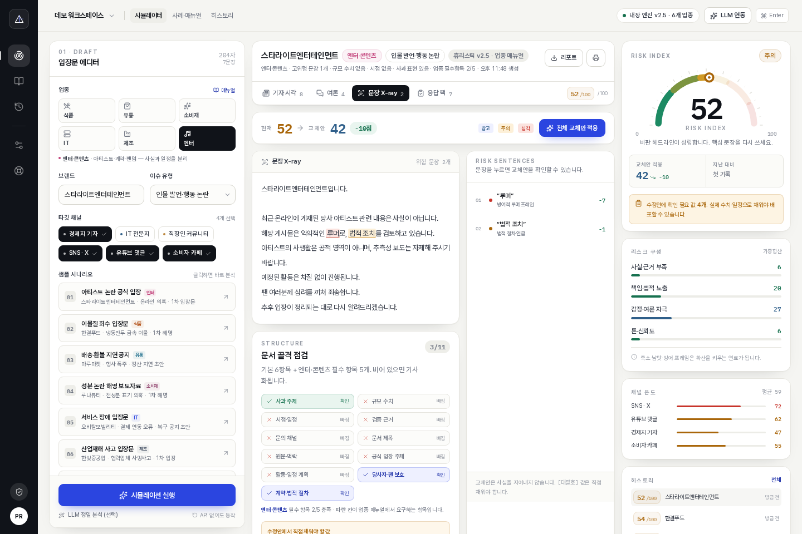
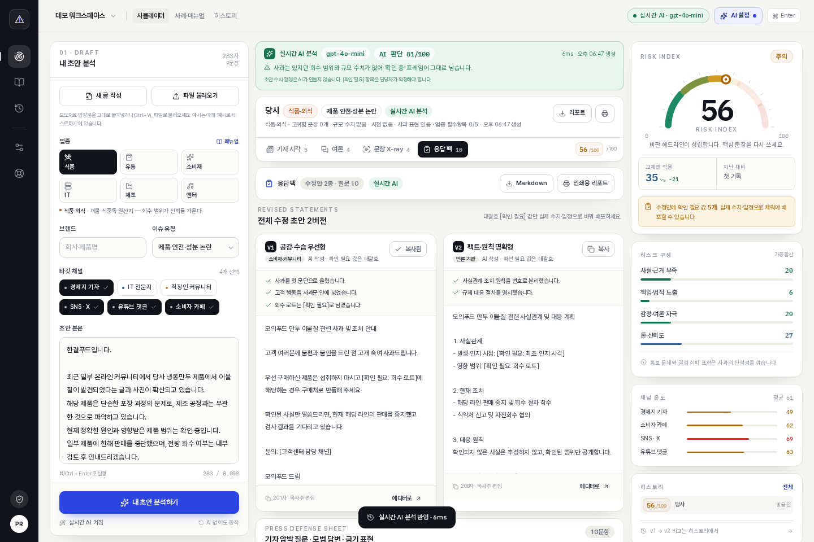
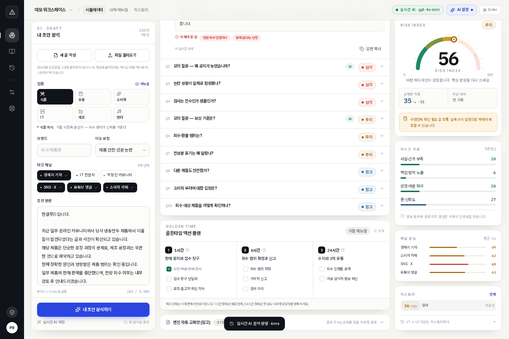
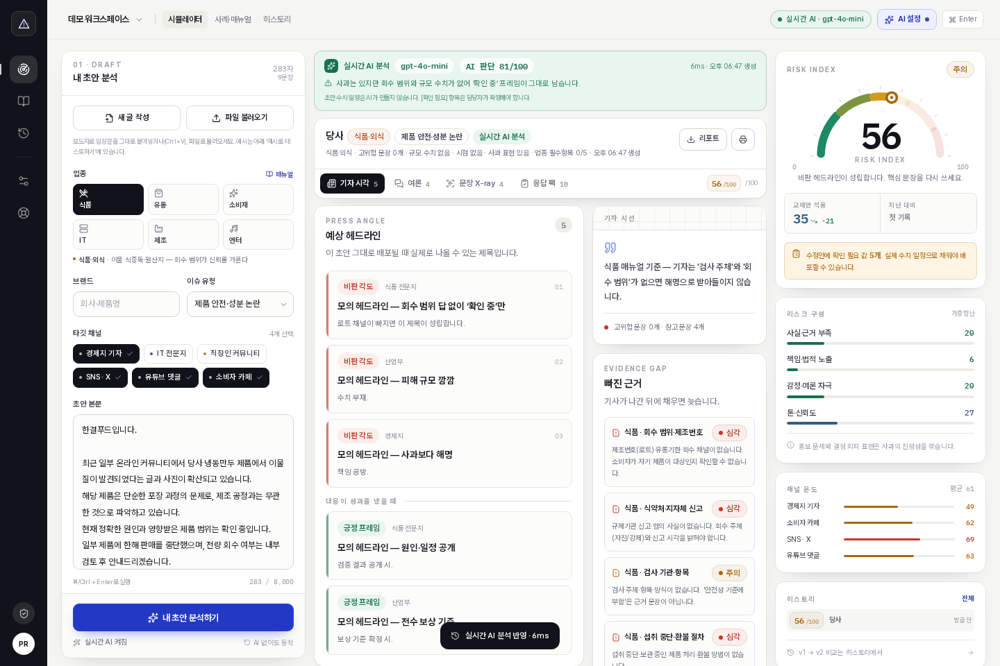
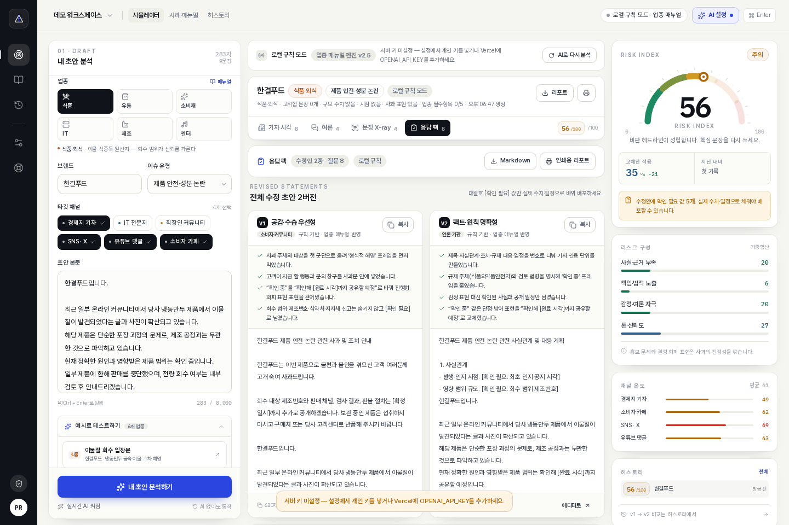
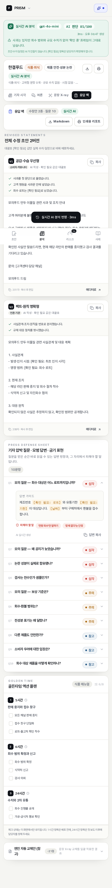

# PRISM — 업종별 PR 위기관리·여론 시뮬레이터

> **초안 한 편을 기자·여론·리스크, 세 개의 시선으로 교차 검증하는 PR 인텔리전스 콘솔.**
> 식품·유통·소비재·IT·제조·엔터 6개 업종의 실제 위기 사례 20건과 업종별 위기관리 매뉴얼을 내장했습니다.
> 입장문을 붙여넣으면 예상 헤드라인, 채널별 반응, 문장별 위험도, 업종 필수 항목 점검, 수정 초안 2버전·기자 답변·골든타임 플랜까지 한 화면에서 나옵니다.
> Vercel 서버리스 함수(`/api/analyze`, gpt-4o-mini)로 실시간 AI 분석을 붙였고, AI가 없거나 실패하면 로컬 규칙 엔진으로 자동 전환합니다.


위기 커뮤니케이션은 “좋은 문장을 쓰는 일”이 아니라 **나가기 전에 어떤 질문을 맞을지 아는 일**입니다. 그런데 그 질문은 업종마다 다릅니다. 식품은 회수 범위, 유통은 환불·정산 기한, 제조는 작업 중지와 원청 책임, 엔터는 원문과 활동 계획이 첫 질문입니다. PRISM은 업종을 고르는 순간 점수 가중치·필수 항목·기자 질문·채널 반응·수정안의 마무리 문장까지 그 업종의 매뉴얼에 맞춰 바꿉니다. 서버 AI가 연결되면 수정 초안 2버전·채널별 반응·기자 답변·골든타임 체크리스트를 다시 쓰고, 연결되지 않으면 같은 항목을 업종 매뉴얼 기반 로컬 규칙으로 채웁니다. 위험 점수는 어느 모드에서든 내장 엔진이 계산해 설명 가능성을 유지합니다.

---

## 1. 핵심 기능

| 영역 | 내용 |
| --- | --- |
| **업종 선택기** | 식품·외식 / 유통·이커머스 / 소비재·뷰티 / IT·플랫폼·핀테크 / 철강·제조·중공업 / 엔터·콘텐츠. 점수 가중치·필수 항목·기본 채널이 함께 바뀜 |
| **3-패널 콘솔** | 초안 에디터 · 분석 탭 · 리스크 레일. 모바일은 하단 4개 내비게이션(초안·분석·리스크·사례) |
| **기자 시각** | 업종 데스크가 쓸 비판/긍정 헤드라인 5개, 기자 압박 질문 + 답변 가이드 + 금기 표현, 빠진 근거 점검 |
| **채널 여론** | 경제지·IT 전문지·직장인 커뮤니티·SNS/X·유튜브·소비자 카페의 예상 부정 톤. 채널별 예상 반응 2~3개와 그 반응을 악화시키는 트리거 |
| **리스크 & 문장 X-ray** | 0~100 리스크 게이지, 4축(근거·책임·감정·톤) 분업, 기본 6항목 + 업종 필수 5항목 골격 점검, 인라인 하이라이트와 `-N점` 교체안 |
| **응답 팩** | ① 공감·수습 우선형 ② 팩트·원칙 명확형 — 완성된 수정 초안 2버전(핵심 변경 포인트·원클릭 복사), 기자 압박 질문별 모범 답변과 금기 표현, 1시간/6시간/24시간 골든타임 체크리스트 |
| **입력 UX** | ‘새 글 작성’으로 즉시 비우기, .txt/.md 파일 불러오기, 예시는 ‘예시로 테스트하기’ 드롭다운으로 분리 |
| **📚 위기 사례 & 업종 매뉴얼** | 실제 사례 20건(모범·혼합·실패) 타임라인·초기 대응·결과·출처, 6개 업종 매뉴얼 열람·인쇄·PDF |
| **히스토리** | localStorage 자동 저장(최대 24건), 두 버전의 리스크 지수·축별 점수·채널 톤 비교 |
| **내보내기** | Markdown 리포트(업종 필수 항목·금기 표현 포함), 인쇄용 리포트, 업종 매뉴얼 PDF |
| **실시간 AI 백엔드** | Vercel `/api/analyze` + OpenAI gpt-4o-mini(JSON 모드). 서버 키가 없으면 개인 키를 프록시로 전달, 그래도 없거나 실패하면 로컬 규칙 모드로 자동 폴백하고 상단에 현재 모드를 표시 |

---

## 2. 업종별 위기관리 매뉴얼

앱 상단 **사례·매뉴얼**에서 읽고, 인쇄하거나 PDF로 받을 수 있습니다. 각 매뉴얼은 같은 7개 블록으로 구성됩니다.

1. **기본 원칙(stance)** — 이 업종에서 첫 문장이 무엇이어야 하는지
2. **주요 위기 트리거 6개** — 발생 유형과 심각도
3. **규제·법적 주체 / 관련 법령** — 누가 조사하고 어떤 법이 걸리는지
4. **골든타임 타임라인** — 1시간 / 6시간 / 24시간 / 72시간 실행 체크리스트
5. **절대 금기 표현** — 왜 쓰면 안 되는지, 대신 무엇을 쓸지
6. **필수 포함 요소** — 초안에 반드시 있어야 하는 값
7. **이해관계자별 대응 톤** — 언론 / 소비자·유가족·팬 / 규제기관 / 내부·거래처의 할 것과 피할 것
   + **증거·기록 확보**, **특히 조심할 것**, **참고 사례**

| 업종 | 이 업종의 첫 질문 | 핵심 규제 주체 |
| --- | --- | --- |
| **식품·외식** | 어느 로트·제조번호까지 회수했나 | 식약처, 지자체·보건소, 농식품부·국립농산물품질관리원, 질병관리청 |
| **유통·이커머스** | 환불·정산은 언제, 얼마를, 누구에게 | 공정위, 개인정보보호위원회, 금융위·금감원, 소비자원 |
| **소비재·뷰티** | 성분 함량과 검사 주체는 무엇인가 | 식약처, 공정위, 소비자원, 국가기술표준원·환경부 |
| **IT·플랫폼·핀테크** | 영향 범위와 복구 ETA, 보상 기준은 | 과기정통부, 개인정보보호위원회·KISA, 금융위·금감원 |
| **철강·제조·중공업** | 작업 중지 범위와 원청 책임은 | 고용노동부, 검찰·경찰, 산업통상자원부, 환경부·지자체 |
| **엔터·콘텐츠** | 원문과 공식 입장, 활동 계획은 | 문체부, 공정위, 방통위·방심위, 법원·수사기관 |

### 매뉴얼이 실제로 바꾸는 것

| 레이어 | 업종 선택 시 달라지는 것 |
| --- | --- |
| **점수** | 축별 가중치(예: 제조는 책임 +6%p, 엔터는 감정 +6%p), 업종 기본 위험도, 업종 필수 항목 누락 감점 |
| **기자 질문** | 업종 필수 항목이 비면 그 질문이 최상위 심각도로 먼저 올라옴 |
| **헤드라인** | 업종 데스크(식품 전문지·유통 전문지·산업·노동 데스크 등)와 업종 고유 각도로 생성 |
| **채널 여론** | 업종별 채널 편향(식품=소비자 카페↑, 제조=직장인 커뮤니티↑, 엔터=SNS·유튜브↑)과 업종 전용 반응 문장 |
| **수정 1차안** | 사과 대상과 마무리 문장이 업종 매뉴얼의 필수 요소로 교체됨 |

예: 같은 “사과드립니다” 초안이라도 **식품**은 “제조번호·회수 채널·환불 절차”, **제조**는 “작업 중지·유가족 지원·조사 협조”, **IT**는 “영향 범위·복구 시각·보상 기준”이 없으면 각각 다른 이유로 점수가 깎입니다.

---

## 3. 위기 사례 라이브러리 — 실제 사례 20건

사례는 **공개 보도·공식 자료로 사실관계(일자·수치·결과)를 확인한 실제 사건**입니다. 각 카드에서 타임라인·초기 대응·결과·교훈과 출처 링크를 볼 수 있습니다. (시뮬레이터의 샘플 기업 7곳은 모두 가상입니다.)

| 업종 | 사례 | 판정 | 핵심 숫자 |
| --- | --- | --- | --- |
| 식품 | 2017 살충제 계란 파동 (KR) | 혼합 | 농장 1,239곳 검사, 52곳 부적합, 회수율 19.2% |
| 식품 | Chipotle E. coli 2015 (US) | 혼합 | 55명 감염, 43개 매장 폐쇄, 4분기 매출 -14.6% |
| 식품 | 맥도날드 쿼터파운더 E. coli 2024 (US) | 모범 | 104명 감염·1명 사망, 24시간 내 공급사 특정 |
| 유통 | 티몬·위메프 정산 지연 2024 (KR) | 실패 | 미정산 1.3조 원, 판매자 4.8만 개사 |
| 유통 | 쿠팡 주소 노출 2021 (KR) | 혼합 | 31만 명, 다음 날 대표 사과 |
| 유통 | 쿠팡 3,370만 계정 유출 2025 (KR) | 실패 | 5개월 미인지, ‘노출’→‘유출’ 2주 만에 정정 |
| 유통 | Target 카드정보 유출 2013 (US) | 실패 | 카드 4,000만 장, 누적 비용 2억 9,100만 달러 |
| 소비재 | 가습기 살균제 2011 (KR) | 실패 | 첫 사망 후 공식 사과까지 5년 |
| 소비재 | 모다모다 THB 논란 2021~2024 (KR) | 혼합 | 금지 원료 지정, 강제 회수 없음, 재고 2024-10까지 판매 |
| 소비재 | 갤럭시 노트7 2016~2017 (KR) | 모범 | 완제품 20만 대 재현 실험, 외부 3개 기관 검증 |
| 소비재 | Sunday Riley 가짜 리뷰 2019 (US) | 실패 | FTC 20년 행정명령, 대표 개인 책임 |
| IT | 카카오 데이터센터 화재 2022 (KR) | 혼합 | 서버 34% 영향, 보상 275억 원, 외부 원인조사 공개 |
| IT | KT 인터넷 먹통 2021 (KR) | 혼합 | 전국 89분, ‘디도스’→‘라우팅 오류’ 정정, 보상 최대 400억 원 |
| IT | CrowdStrike 글로벌 장애 2024 | 혼합 | 윈도우 850만 대, Fortune 500 손실 54억 달러 추정 |
| 제조 | 김용균 사망 2018 (KR) | 실패 | 정부 대책 6일, 산업안전보건법 전부개정 |
| 제조 | 화성 아리셀 화재 2024 (KR) | 실패 | 사망 23명 중 20명 하청, 불법 파견 의혹 |
| 제조 | 포스코 포항제철소 침수 2022 (KR) | 모범 | 고로 3기 전면 중단 → 1주일 재가동, 3개월 공급 약속 |
| 엔터 | 하이브–민희진 갈등 2024 (KR) | 혼합 | 감사·기자회견·문서 공개 경쟁 |
| 엔터 | 김호중 음주 뺑소니 2024 (KR) | 실패 | 5일간 3차례 부인, 1심 징역 2년 6월 |
| 엔터 | 프로듀스101 조작 2019 (KR) | 실패 | 사과까지 5개월, 보상 기준 미확정, 방심위 과징금 |



---

## 4. 샘플 시나리오 (가상 기업 7종)

업종마다 최소 한 개의 샘플 초안이 있고, 클릭하면 입력·분석까지 바로 실행됩니다. 브랜드명과 초안은 직접 수정할 수 있습니다.

| # | 브랜드(가상) | 업종 | 이슈 | 초안 성격 |
| --- | --- | --- | --- | --- |
| 01 | 한결푸드 | 식품 | 제품 안전 | 냉동만두 금속 이물 — “단순한”, “일부 제품”, “전량 회수 여부 검토” |
| 02 | 마루마켓 | 유통 | 서비스 장애 | 배송·환불 지연 — “시스템 오류”, “순차 처리”, 셀러 정산 방치 |
| 03 | 루나뷰티 | 소비재 | 제품 안전 | 전성분 표기 의혹 — “과도한 우려”, “업계 최고” |
| 04 | 오비탈모빌리티 | IT | 서비스 장애 | 결제 오류 — “관계자에 따르면”, “대부분 복구” |
| 05 | 한빛중공업 | 제조 | 산업재해 | 협력업체 사망 — “협력업체 소속”, “작업자 부주의” |
| 06 | 스타라이트엔터테인먼트 | 엔터 | 인물 논란 | 아티스트 의혹 — “사실이 아닙니다”, “법적 조치”, “사생활” |
| 07 | 테크노바 | IT | 요금·정책 | 요금 인상 — “별도 안내 없이”, “불가피한 조치”, “위약금” |

---

## 5. 리스크 엔진은 어떻게 점수를 내나

룰 + 휴리스틱 기반이며, **초안에 없는 사실을 만들지 않는 것**을 원칙으로 합니다.

1. **문장 분해** — 줄바꿈·마침표 기준으로 문장 경계를 잡고, 위험 구절의 위치를 원문 오프셋으로 유지합니다.
2. **위험 구절 탐지** — 30개 규칙(출처 불명, 축소 표현, 보상 약속, 사전 고지 누락, 불가피성 강조, 홍보 문체 등)을 적용하고 겹치는 매치는 심각도가 높은 것만 남깁니다.
3. **분야 점수** — 근거 부족 · 책임·법적 노출 · 감정·여론 자극 · 톤·신뢰도 4축을 가중 합산. 가중치는 업종에 따라 보정됩니다.
4. **업종 필수 항목** — 업종별 5개 항목(예: 로트 번호, 환불 기한, 작업중지, 원문·맥락)의 포함 여부를 정규식으로 판정해 누락분을 감점하고 질문·근거 누락에 반영합니다.
5. **구조 보정** — 사과 주체·규모 수치·시점·문의 채널·검증 근거·문서 제목, 이슈 유형 기본 위험도, 선택 채널의 확산 성향을 가감합니다.
6. **교체 델타** — 각 교체안을 실제로 적용한 텍스트를 다시 채점해 `-N점`을 계산합니다(추정치 아님).

| 점수 | 등급 | 의미 |
| --- | --- | --- |
| 0–24 | 안정 | 지금 문장으로 배포해도 치명적 결함은 적음 |
| 25–44 | 관찰 | 질문 몇 개로 흔들릴 수 있음 |
| 45–64 | 주의 | 비판 헤드라인이 성립 |
| 65–84 | 경계 | 2차 논란 가능성 높음, 재작성 필요 |
| 85–100 | 위험 | 사과가 아니라 방어로 읽힘 |

> 점수는 절대적 진단이 아니라 **초안 간 상대 비교와 개선 방향**을 위한 지표입니다. 실제 법률·언론 대응 전에는 담당자 검토가 필요합니다.

### 실시간 AI 분석 (Vercel 서버리스)

`api/analyze.ts`가 POST `{ brand, industry, issue, channels, draft, context }`를 받아 gpt-4o-mini(JSON 모드)로 다음을 만듭니다.

- 수정 초안 2버전(공감·수습 / 팩트·원칙)과 핵심 변경 포인트
- 선택한 채널별 예상 반응 2~3개와 악화 트리거
- 기자 압박 질문 + 모범 답변 가이드 + 금기 표현
- 업종 규제 주체·법령·매뉴얼을 반영한 1시간/6시간/24시간 액션 체크리스트
- 헤드라인·팩트체크 질문·AI 총평

키 우선순위: `GEMINI_API_KEY`(서버) → 개인 키가 `sk-…`가 아니면 Gemini, `OPENAI_API_KEY`(서버) → 요청 본문 `apiKey` → `x-api-key` 헤더(둘 다 없을 때, `sk-…`는 OpenAI). Gemini 키는 `AIza…`·`AQ.…` 형식 모두 지원합니다. Gemini는 `generationConfig.responseMimeType: "application/json"`으로 같은 구조화 JSON을 받습니다. 입력은 8,000자까지, 초과 시 413을 반환하고 클라이언트는 로컬 모드로 남습니다. CORS·OPTIONS·GET 상태 확인을 지원하며 키 값은 응답에 포함하지 않습니다.

- 상단 배지가 **실시간 AI 분석** / **로컬 규칙 모드**를 구분하고, 로컬로 떨어진 이유를 표시합니다. ‘AI로 다시 분석’으로 재시도할 수 있습니다.
- 서버 키가 없으면 설정 모달에서 개인 키를 넣을 수 있습니다. 개인 키는 브라우저 로컬 저장소에만 보관되고 이 사이트의 `/api/analyze` 프록시로만 전송됩니다.
- 정적 호스팅(GitHub Pages)에는 `/api/analyze`가 없으므로 자동으로 로컬 규칙 모드로 동작합니다. 두 배포를 같은 코드로 유지합니다.

---

## 6. 화면

| 사례·매뉴얼 | 업종 매뉴얼 패널 | 모바일 사례 |
| --- | --- | --- |
|  |  |  |

| 문장 X-ray + 업종 필수 항목 | 응답 팩 · 수정 2버전 | 골든타임 플랜 |
| --- | --- | --- |
|  |  |  |

| 실시간 AI 모드 | 로컬 폴백 | 모바일 응답 팩 |
| --- | --- | --- |
|  |  |  |

모바일은 하단 내비게이션 4개(초안·분석·리스크·사례)로 전환합니다. 1024px 태블릿은 2단, 1280px 이상에서 3-패널 레일이 열립니다.

### 업종 매뉴얼 PDF

`docs/prism-industry-playbooks.pdf` — 표지 + 6개 업종 매뉴얼 13쪽. 앱의 **사례·매뉴얼 → 인쇄**로 같은 내용을 인쇄할 수 있고, `python3 scripts/export-playbooks.py`로 재생성합니다.

---

## 7. 실행

```bash
npm install
npm run dev        # http://localhost:5182
npm run build      # tsc --noEmit + vite build
npm run preview    # http://localhost:4182
```

Node 20+ / Vite 7 / React 19 / TypeScript / Tailwind CSS v4.

### Vercel 배포

```bash
npm i -g vercel
vercel            # 프리뷰
vercel --prod     # 운영
```

Vercel 프로젝트 설정에서 환경변수 **`GEMINI_API_KEY`**(Google AI Studio 키, 기본 모델 `gemini-3.5-flash-lite` — 실측 2.2초 응답) 또는 **`OPENAI_API_KEY`** 를 추가하면 실시간 AI가 켜집니다. 신규 키는 `gemini-2.5-flash`가 404로 거절되고 `gemini-3.8-flash`는 thinking으로 15~25초 걸려 Vercel 타임아웃 위험이 있어 flash-lite를 기본값으로 씁니다. 둘 다 있으면 Gemini를 씁니다(모델은 `GEMINI_MODEL`로 변경). `vercel.json`이 Vite SPA(`dist/`)와 `api/analyze.ts`를 함께 배포하며, GitHub Pages용 `GITHUB_ACTIONS` base 경로 분기는 그대로 유지됩니다. 서버 키 없이 배포해도 앱은 로컬 규칙 모드로 완전히 동작합니다.

---

## 8. 데이터와 프라이버시

- 초안·분석 기록·개인 API 키는 브라우저 localStorage에만 저장됩니다. 실시간 AI를 켜면 초안이 분석 요청 본문으로 `/api/analyze`에 전송되고, 서버는 이를 저장하지 않습니다(OpenAI 호출 후 폐기).
- API 키는 서버 응답·로그에 남기지 않습니다. 서버 키(`GEMINI_API_KEY`·`OPENAI_API_KEY`)는 Vercel 환경변수로만 보관합니다.
- 히스토리는 최대 24건, 앱에서 즉시 삭제할 수 있습니다.
- 시뮬레이터의 기업·제품·인물·반응은 전부 가상이며 실제 회사·개인 정보를 사용하지 않습니다.
- 사례 라이브러리의 기업·기관은 실명이지만, 공개된 보도·공식 자료의 사실만 요약했습니다. 개별 출처 링크를 카드에 표시합니다.
- 분석 결과의 `[대괄호]` 값은 실제 수치·일정으로 교체해야 하는 자리입니다.

---

## 9. 프로젝트 구조

```
src/
├─ App.tsx                  # 3-패널 레이아웃, 업종 상태, 실행/적용/히스토리
├─ types.ts                 # Analysis·RiskSpan·Industry·CrisisCase 등 도메인 타입
├─ components/
│  ├─ Sidebar · TopBar      # 내비게이션과 엔진 상태
│  ├─ InputPanel            # 업종 선택기·브랜드·이슈·채널·샘플·에디터
│  ├─ IndustrySelector      # 6개 업종 선택
│  ├─ LibraryView           # 사례 카드 + 업종 매뉴얼 패널
│  ├─ PlaybookPrint         # 매뉴얼 인쇄 레이아웃
│  ├─ RiskGauge · RiskRail  # 게이지·축별 구성·채널 온도·최근 기록
│  ├─ HistoryView           # 버전 비교와 기록 관리
│  ├─ ModeBanner            # 실시간 AI / 로컬 규칙 모드 표시·재시도
│  ├─ RevisionCards         # 수정 초안 2버전 카드(복사·에디터로)
│  ├─ GoldenTimePlan        # 1·6·24시간 체크리스트
│  ├─ ApiModal · EmptyState · PrintReport
│  └─ tabs/                 # PressTab · SentimentTab · XrayTab · ResponseTab
└─ lib/
   ├─ presets.ts            # 이슈·채널 정의, 가상 샘플 7종
   ├─ industries.ts         # 6개 업종 매뉴얼·필수 항목·가중치·업종 Q&A
   ├─ cases.ts              # 실제 위기 사례 20건과 출처
   ├─ rules.ts              # 30개 위험 규칙과 문구 단위 교체안
   ├─ engine.ts             # 문장 분해·탐지·업종 채점·헤드라인·여론·Q&A
   ├─ sentiment.ts          # 채널별·업종별 예상 반응 코퍼스
   ├─ korean.ts             # 은/는·이/가·을/를·로/으로 조사 처리
   ├─ ai.ts                 # /api/analyze 호출·검증·Analysis 병합·오류 사유
   ├─ enhance.ts            # 로컬 폴백: 수정 2버전·채널 시뮬레이션·답변·골든타임
   ├─ report.ts             # Markdown 리포트 생성(2버전·답변·골든타임 포함)
   └─ storage.ts            # localStorage 히스토리·설정

api/analyze.ts              # Vercel 서버리스 함수 (OpenAI gpt-4o-mini)
vercel.json                 # Vite SPA + 서버리스 함수 배포 설정
```

---

## 10. 검증

| 항목 | 결과 |
| --- | --- |
| `npx tsc --noEmit` | 오류 0 |
| `npm run build` | 성공 (JS 534 kB / gzip 166 kB, CSS 50 kB / gzip 9.8 kB) |
| Playwright Chromium (1440×960, 1024×820, 390×844) | JS 콘솔·페이지 오류 0 |
| `scripts/verify_ai.py` — 실시간 AI·폴백 | **46/46 통과** — API 계약(400/413/501/502 JSON), 모의 OpenAI 응답 병합, 실시간 AI 모드 배지, 수정 2버전·복사(클립보드), 기자 답변·금기 표현, 골든타임 3구간·체크, 채널 악화 트리거, 파일 불러오기, 새 글 비우기, 서버 키 없음→로컬 폴백→개인 키로 실시간 승격, 정적 호스팅 폴백, 모바일 390px 가로 넘침 없음 |
| `scripts/verify.py` — 기존 기능 회귀 | 35개 항목 전부 통과 — 업종 6개, 업종별 점수·필수 항목·Q&A·수정안, X-ray 적용, 사례 필터·타임라인·출처, 매뉴얼 전환·인쇄, 히스토리 비교, 모바일 사례·매뉴얼 |
| 산출물 | 스크린샷 28장(`docs/screenshots/`), 업종 매뉴얼 PDF 14쪽(`docs/prism-industry-playbooks.pdf`) |

### AI 백엔드 검증 방법

```bash
npm run build
node_modules/.bin/esbuild api/analyze.ts --bundle --format=esm --platform=node --outfile=.tmp/analyze.mjs
python3 scripts/verify_ai.py
```

`scripts/serve-ai.mjs`(dist + 실제 핸들러), `scripts/mock-openai.mjs`(모의 OpenAI, `MOCK_FAIL=1`이면 500)를 띄워 **실제 서버리스 코드를 그대로** 검증합니다. `scripts/verify.py`(기능 회귀·스크린샷), `scripts/shots.py`(스크린샷), `scripts/export-playbooks.py`(PDF)도 Playwright로 재생성합니다.

---

## 11. 알려진 한계

- 내장 엔진은 규칙·정규식 기반이라 문맥을 완전히 이해하지는 못합니다. 업종 필수 항목 판정도 표현이 조금만 달라지면 놓칠 수 있어, X-ray의 항목명과 매뉴얼을 함께 봐야 합니다.
- 교체안은 **초안**이며, 숫자·일정은 반드시 담당자가 확정해야 합니다.
- 사례는 공개 자료 기준으로 요약했습니다. 소송·수사가 진행 중인 사안은 이후 결과가 달라질 수 있습니다.
- 법령·감독 기준은 개정됩니다. 매뉴얼은 배포 전 최신 기준과 사내 법무 검토를 전제로 합니다.
- 실시간 AI는 서버리스 함수의 제한 시간(최대 60초)과 OpenAI 응답 속도에 영향을 받습니다. 느리거나 실패하면 로컬 규칙 모드로 남고, 초안이 8,000자를 넘으면 AI를 건너뜁니다.
- AI가 만든 문안은 초안에 없는 수치를 만들지 않도록 프롬프트로 제한하지만, 배포 전 사람이 [확인 필요] 값을 반드시 채워야 합니다.
- 인쇄 리포트는 Chromium/Safari 인쇄 미리보기 기준으로 최적화되어 있습니다.
- 히스토리는 브라우저에 종속됩니다. 다른 기기와 동기화되지 않습니다.

---

PRISM — PR Intelligence Console · 시뮬레이터 시나리오는 가상, 사례 라이브러리는 공개 자료로 확인한 실제 사건입니다.
