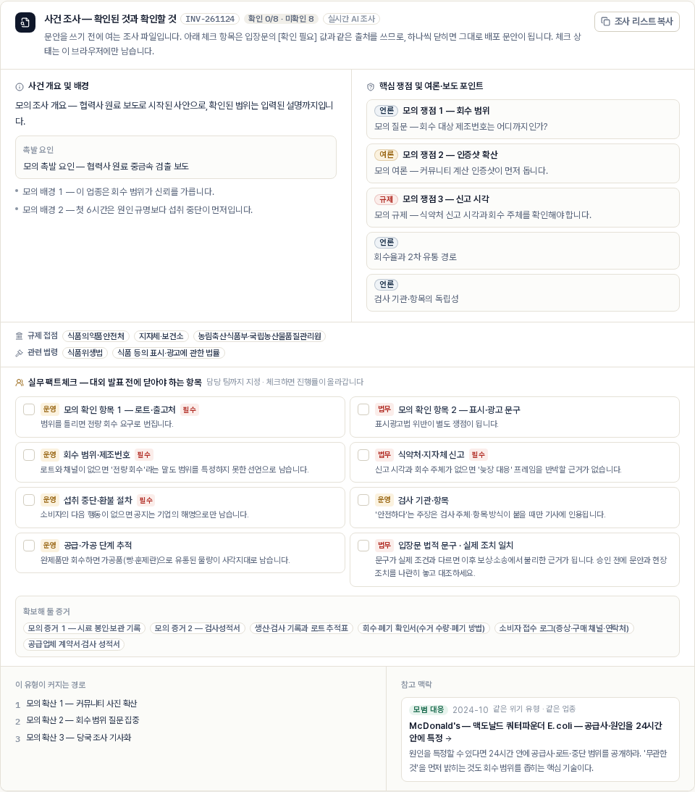
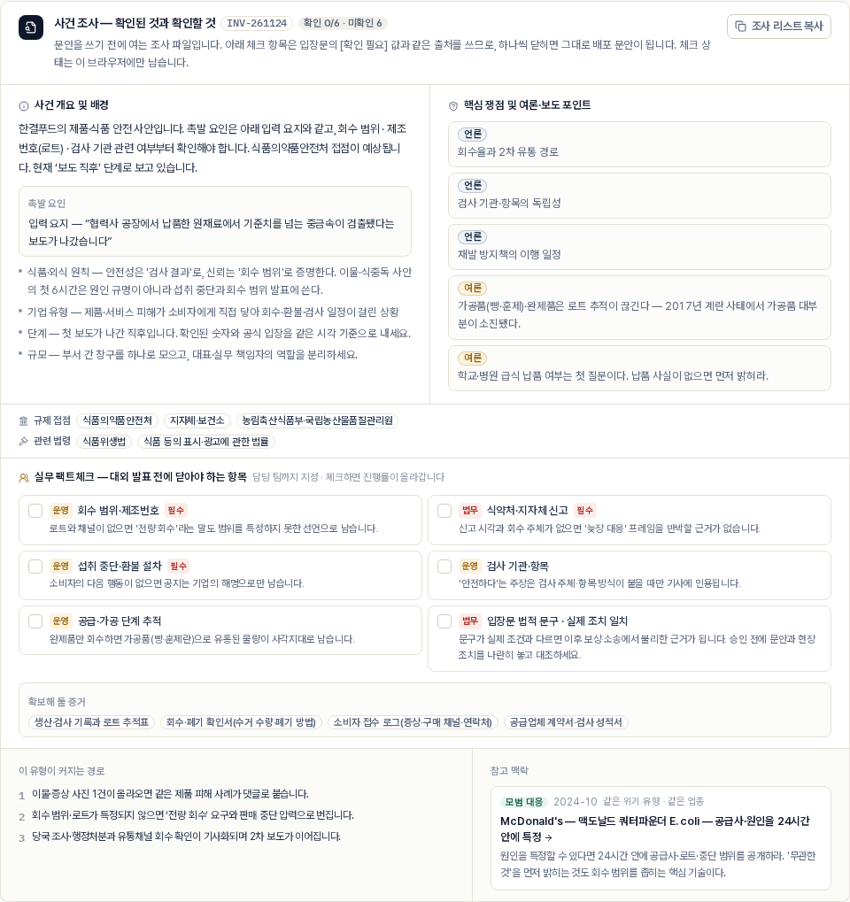
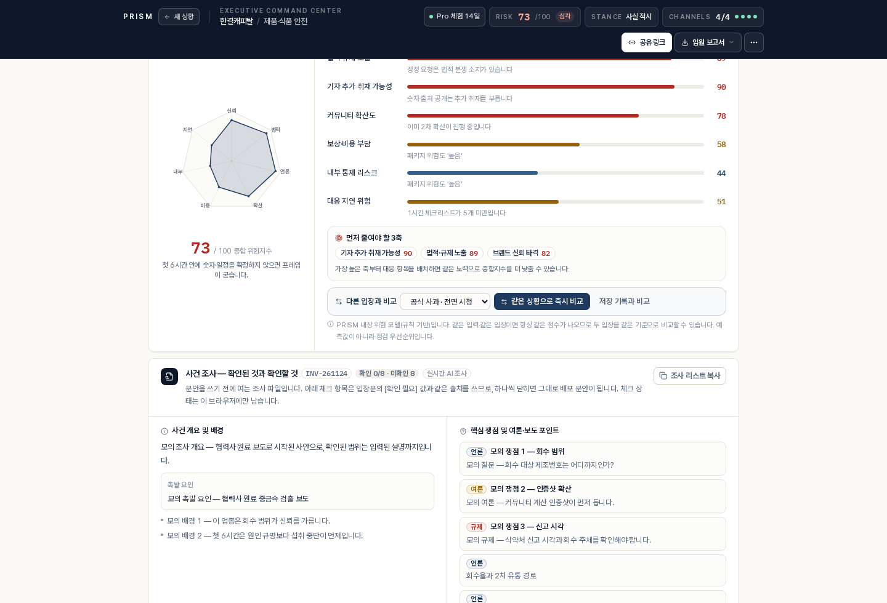
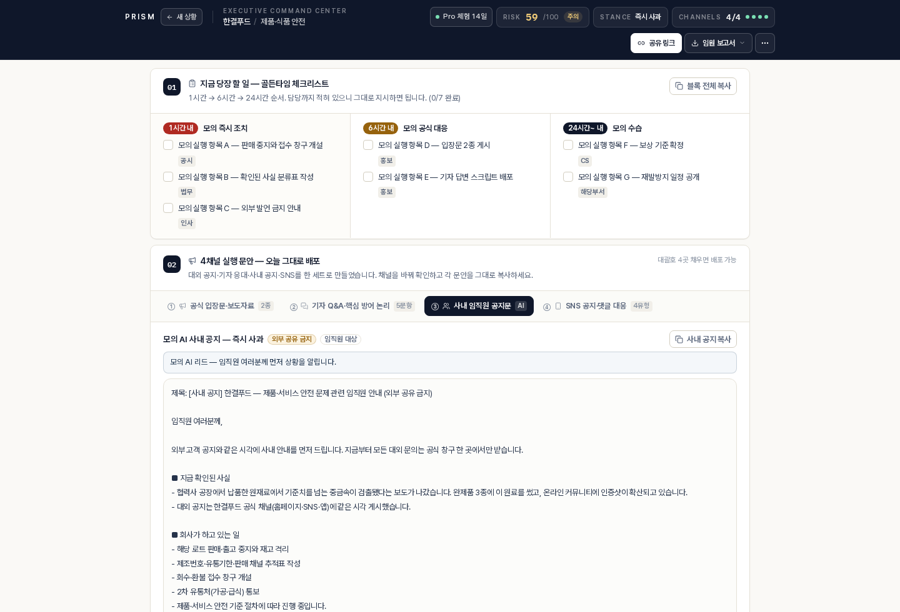
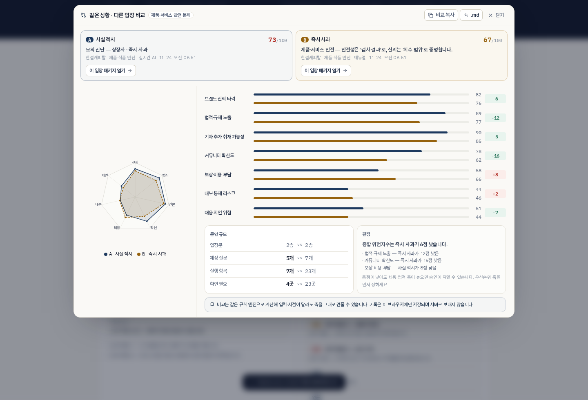
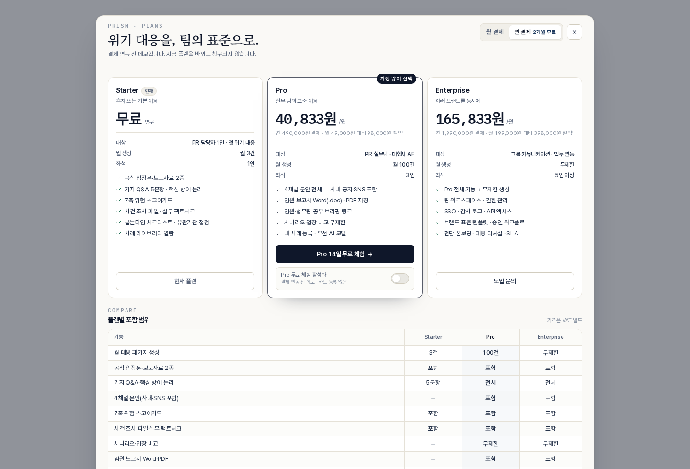
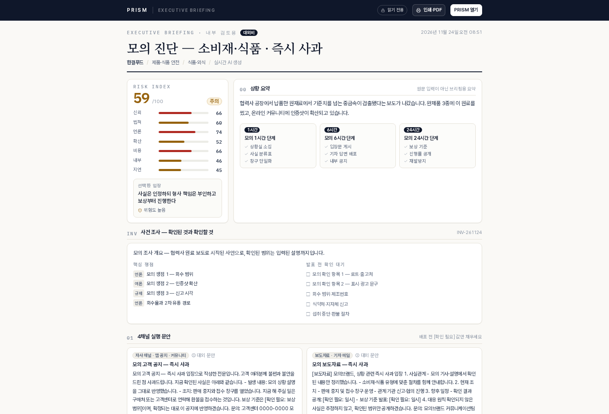

# PRISM — 위기 한 줄이면, 바로 쓰는 대응 패키지

> **상황 한 줄(‘가격 인상’처럼 짧은 키워드도) 또는 기사 URL을 넣고 우리 입장을 고르면, 오늘 바로 실행·복붙할 수 있는 위기 대응 패키지가 한 화면에 나옵니다.**
> 골든타임 체크리스트 · 고객 공지/언론 배포 입장문 2종 · 압박 질문과 답변 스크립트 · 유관기관 대응 · 악화 시 다음 대응까지.
> 상장사(공시·IR·주가), 소비재·식품(리콜·식약처), IT·플랫폼(개인정보·장애), 엔터·크리에이터, 노사·내부고발·오너 리스크, **가격·요금 인상** —
> **상황 유형을 고르면 각 섹션이 그 유형의 절차·법령·이해관계자로 다시 써집니다.**
>
> **대응 대안 6종 + 직접 입력 · 사업분야 12종 · 기업 상황 12종** — 같은 사안도 ‘어떤 입장을 고르고, 어떤 회사 상황인지’에 따라
> 입장문·기자 답변·체크리스트·모범/실패 대조가 전부 달라집니다.
> **v8** — 임원 커맨드 바 · 임원·법무 공유 브리핑 링크 · Starter/Pro/Enterprise 요금제(결제 연동 전 데모).
> **v9** — **사건 조사(Incident file)**: 이슈를 넣으면 ‘무슨 사건이고, 대외 발표 전에 무엇을 확인해야 하는지’를
> 개요·쟁점·실무 팩트체크·확산 경로로 먼저 정리합니다.


기존 PRISM은 “내 초안을 진단하는 콘솔”이었습니다. 현장에서 필요한 건 진단이 아니라 **지금 무엇을 하고, 무엇을 올리고, 뭐라고 답할지**입니다.
그래서 입력을 하나로 줄이고(상황/URL + 입장 + 유형), 출력을 실행 순서대로 다시 세웠습니다.

- AI가 연결되면 서버가 **기사 본문을 직접 읽고** Gemini로 패키지를 씁니다. 연결되지 않아도 **매뉴얼 엔진**이 같은 구조의 패키지를 즉시 만듭니다.
- 확인되지 않은 사실은 만들지 않습니다. 필요한 값은 `[확인 필요: 항목]`으로 남기고, 그 개수를 화면에 표시합니다.

---

## 1. 입력 — 첫 화면은 카드 하나

| 항목 | 내용 |
| --- | --- |
| **위기 상황 또는 기사 URL** | 한 줄 설명. **4자 이상이면 ‘가격 인상’ 같은 키워드만으로도 분석**하며, 짧은 입력은 소비자 반발·명분·커뮤니티·경쟁사·언론 포인트 5축으로 쟁점을 먼저 확장합니다. `http(s)://…`가 들어 있으면 `/api/analyze`가 서버에서 HTML을 받아 title·meta description·본문을 추출해 프롬프트에 넣습니다. |
| **현재 단계** | `공지 전` / `보도 직후` / `여론 확산` — 1시간 체크리스트의 선행 항목과 진단 문장이 달라집니다. |
| **기업 규모** | `스타트업·중소` / `중견` / `대기업` / `글로벌` — 대표 직접 설명, 계열사 동일 문안, 현지 규제 확인 등 이해관계자 접점을 보정합니다. |
| **대응 대안 (1탭, 7가지)** | `공식 사과·전면 시정` / `사실 적시·팩트체크` / `유감 표명·조사 경과` / `선제 보상·상생안` / `무대응·모니터링` / `강경 대응·법적 조치` / **`직접 입력`**. 입장마다 입장문 구성, 금기 표현, 예상 Q&A, 여론 전망이 따로 있고, 고르면 ‘이 입장을 고르는 상황 / 주의점’이 바로 표시됩니다. `직접 입력`은 현장 판단을 한 줄로 적으면 그 문장이 문안 첫 문단과 톤의 기준이 됩니다. |
| **사업분야(업종)** | 12종을 5개 그룹으로 묶어 제공: 식품·외식 / 유통·이커머스 / 소비재·뷰티 / IT·플랫폼 / **B2B·SaaS·엔터프라이즈** / **금융·핀테크** / **모빌리티·제조** / **여행·항공·숙박** / 철강·제조 / 엔터·콘텐츠 / 건설·부동산 / 제약·바이오. 업종을 고르면 그 분야 **예시 상황 5개**가 칩으로 뜨고, 누르면 입력란에 들어갑니다. |
| **기업 상황 (최대 3개)** | `회사 단계`(상장·대기업 / IPO 준비 / 자금난 / M&A) · `고객 구조`(B2C / B2B / 해외) · `지금 여론·기관`(초기 루머 / 확산 중 / 당국 조사 / 노사·내부 제보 / 오너 리스크). 고른 조건은 체크리스트·함정·AI 프롬프트에 반영되고, 칩으로 안 잡히는 상황은 직접 입력합니다. |
| **기업 유형 (최대 3개)** | `일반 기업·브랜드` · `상장사(공시·IR·주가)` · `소비재·식품(리콜·CS)` · `IT·플랫폼(유출·장애)` · `엔터·크리에이터(팬덤)` · `노사·내부고발·오너 리스크`. 첫 선택이 대표, 나머지는 보강 레이어로 모든 섹션에 합쳐집니다. |
| **선택 입력** | 브랜드명(비우면 “당사”), `.txt/.md` 첨부, 기존 입장문 검수 모드 |

---

## 2. 출력 — 쟁점 확장 → 전체 시스템 → 실행 순서 7블록

- **사건 조사 (Incident file)** — 스코어카드 바로 아래에 조사 파일 번호·사건 개요·촉발 요인·규제 접점/법령·핵심 쟁점(언론·여론)·**실무 팩트체크 리스트**(담당 팀·필수 표시·체크 진행률)·확보할 증거·확산 경로·참고 사례를 한 카드로 모읍니다. 아래 `2-0` 참고.
0. **00 쟁점 확장 (Issue brief)** — 이 유형에서 먼저 잡아야 할 쟁점 5~7개, 숫자로 채워야 할 항목, 입력에 없어 가정한 부분을 한 카드에 모았습니다(여론·보도 포인트는 ‘사건 조사’ 카드로 이동). 짧은 입력에서도 ‘무엇을 문제로 보고 있는지’ 먼저 확인할 수 있습니다.
1. **전체 대응 시스템 (Overview)** — `① 1시간 현황 파악·임시 대응` → `② 6시간 공식 입장·유관기관/언론` → `③ 24시간~ 수습·재발방지`.
   각 단계에 **목표(goal)** 와 **다음 단계로 넘어가기 위한 통과 기준(gate)** 을 붙였고, 아래에 “동시에 움직일 곳”을 칩으로 모았습니다.
2. **01 지금 당장 할 일** — 1시간/6시간/24시간 체크리스트. 항목마다 담당(공시·법무·CS·보안·노무…) 표시, 화면에서 체크하며 진행률을 볼 수 있습니다.
3. **02 4채널 실행 문안** — ① 공식 입장문 2종 ② 기자 Q&A·핵심 방어 논리 ③ 사내 임직원 공지 ④ SNS 공지·댓글 대응을 탭으로 묶었습니다. 아래 `2-1` 절 참고. 유형별 법적 문구(공시 절차, 개인정보보호법 제34조 72시간 신고, 식품위생법 자진회수, 산업안전보건법 제54조 즉시 보고 등)가 본문에 들어갑니다. 블록별·편별 원클릭 복사.
4. **③ 사내 공지 · ④ SNS**까지 같은 사실·숫자·일정으로 연결됩니다. 인쇄·PDF에서는 네 채널이 모두 펼쳐집니다.
5. **03 유관기관·이해관계자 대응** — 거래소 공시팀, 금감원, 개인정보보호위원회/KISA, 식약처, 고용노동부, 노조, 팬덤, 광고주… 누구에게 **언제 무엇을** 말하고, **첫 문장**은 무엇으로 시작할지.
6. **04 예상 여론 & 악화 시 다음 대응** — 채널별 예상 반응, 악화 트리거, 악화됐을 때 실행 순서.
7. **05 같은 유형의 실제 사례 · 06 사례에서 뽑은 대응 순서** — 검수 완료 사례 중 유형·업종·키워드가 맞는 것만. 모범 사례의 절반 이상이 실행한 단계에 ‘핵심’ 표시.
8. **07 모범 사례 vs 실패 사례** — 같은 유형에서 결과가 갈린 두 사례를 **7개 축**(사과·숫자 공개·보상·재발 방지·2차 피해 차단·원인 공개·법적 대응)으로 좌우 비교합니다. 각 칸은 사례 원문 문장을 인용하고, 없으면 ‘해당 조치 없음’으로 표시합니다. 모범 사례가 아직 없는 유형은 **실패 사례 vs 이 유형의 표준 프로토콜**로 바꿔, 실패 사례에서 빠진 항목을 짚어 줍니다.

**기존 입장문 검수 모드**는 별도 토글입니다. 위험 표현을 초안에서 그대로 인용해 이유와 교체 문장을 주고, 배포 가능한 리라이트를 만듭니다.

---

## 2-0. 사건 조사 (Incident file) — 대응 문안 전에 여는 조사 카드

이슈 한 줄을 넣으면 대부분의 도구는 곧바로 “사과문”을 씁니다. 현장에서는 그 전에 **무슨 사건이고, 어디까지 확인됐고, 발표 전에 무엇을 닫아야 하는지**가 먼저입니다.
그래서 스코어카드 아래에 **조사 파일**(`src/lib/investigation.ts`, 화면 `InvestigationBlock`)을 따로 두었습니다.

| 구역 | 내용 |
| --- | --- |
| **사건 개요 및 배경** | 조사 파일 번호(`INV-YYMMDD`), 사건 개요 2~4문장, **촉발 요인**(업종 매뉴얼의 트리거와 입력 문장을 대조해 매칭), 업종 원칙·기업 유형·단계·규모 |
| **규제 접점 · 관련 법령** | 업종 매뉴얼의 규제기관(역할 툴팁)과 관련 법령 칩 |
| **핵심 쟁점 및 여론·보도 포인트** | 이슈 유형의 언론 보도 포인트 + 업종에서 반복되는 여론 공격 지점을 `언론 / 여론 / 규제` 태그로 |
| **실무 팩트체크 — 대외 발표 전에 닫아야 하는 항목** | 업종 점검 항목을 담당 팀(**PR·법무·운영·데이터**)·필수(severity 3) 표시와 함께 체크리스트로. 체크하면 `확인 n/총 n · 미확인 n` 진행률이 갱신되고, ‘조사 리스트 복사’로 팀에 그대로 넘깁니다. 체크 항목은 입장문의 `[확인 필요]` 값과 **같은 출처**를 씁니다 |
| **확보해 둘 증거** | 업종 매뉴얼의 증거 항목(생산·검수 기록, 접수 로그, 계약서 등) |
| **이 유형이 커지는 경로** | 이슈 유형 16종별 3단계 확산 경로(일반 경로이며, 특정 사건의 사실로 단정하지 않습니다) |
| **참고 맥락** | 같은 유형의 검수 사례 1건 — 결과 배지·매칭 이유·교훈, 클릭하면 사례 라이브러리로 |

- **AI가 연결되면** `/api/analyze`의 `investigation` 스키마로 개요·촉발 요인·쟁점·확인 항목·증거·확산 경로를 상황에 맞게 다시 씁니다. 응답이 길이 제한으로 잘려 일부 칸이 비어도, 로컬 매뉴얼의 업종 점검 항목·증거·확산 경로가 겹치지 않는 것만 뒤에 붙습니다(빈 카드가 생기지 않음).
- **모든 요금제 포함** — Starter에서도 조사 카드·팩트체크·복사가 그대로 동작합니다(요금제 비교표에도 명시).
- **내보내기 연동** — 인쇄/PDF에는 카드가 그대로 인쇄되고, Word(.doc)·Markdown(.md) 보고서에는 `2. 사건 조사` 섹션으로, 임원·법무 공유 브리핑(`#share=`)에는 개요 + 핵심 쟁점 + ‘발표 전 확인 대기’로 들어갑니다.




## 2-1. 상용 고도화 — 4채널 실행 문안 · 7축 스코어카드 · 입장 비교 · 임원 보고서

B2B 실무에서 “회사가 돈을 내고 PR 팀이 매일 쓰는 도구”가 되려면 문안만으로는 부족합니다.
대표가 결재하는 보고서, 사내 공지, SNS 운영까지 같은 사실로 이어져야 하고, 어느 입장이 나은지 숫자로 보여야 합니다.

### ① 4채널 실행 문안 (탭)

| 채널 | 내용 |
| --- | --- |
| **① 공식 입장문·보도자료** | 고객·커뮤니티 공지 + 언론 배포·기자 회신 2종 (블록별 복사) |
| **② 기자 Q&A·핵심 방어 논리** | 압박 질문 5~7개 + 그대로 읽는 답변, **방어 논리 3축**(쓸 문장·필요한 근거·피할 말), 공격적 질문을 사실로 되돌리는 **브릿지 문장**, 금기 표현 |
| **③ 사내 임직원 공지문** | 외부 공지와 같은 시각에 나가는 사내 공지 전문, 임직원이 할 일 / 하지 말아야 할 말, “기자가 내 번호로 전화했다” 같은 사내 질문 답 |
| **④ SNS 공식 계정** | X·스레드용 200자 이내 공지, 인스타 캡션, 고정 댓글, 카드뉴스 4장, **예상 댓글 유형별 답글**(안내·사실·공감·비공개), 악화 시 댓글 운영 원칙 |

> ③④는 AI가 연결되면 AI가 쓰고(프롬프트 `channels` 스키마), 응답이 없거나 형식이 어긋나면 매뉴얼 엔진 문안이 그대로 나갑니다. 어느 경우에도 빈 탭이 생기지 않습니다.

### ② 7축 위험 스코어카드 (`src/lib/scorecard.ts`)

브랜드 신뢰 타격 · 법적·규제 노출 · 기자 추가 취재 가능성 · 커뮤니티 확산도 · 보상·비용 부담 · 내부 통제 리스크 · 대응 지연 위험 — **0(안전)~100(심각)** 으로 통일했습니다.
SVG 레이더 + 축별 막대로 표시하고, 각 축에 **왜 그 점수가 나왔는지**(입력 신호·입장 보정·기업 상황 태그·확인 필요 항목 수)를 함께 적습니다.
규칙 기반이라 같은 입력·같은 입장이면 항상 같은 값이 나오고, AI 응답과 무관하게 비교 기준이 고정됩니다. 점수는 예측값이 아니라 **점검 우선순위**입니다.

### ③ 같은 상황 · 다른 입장 비교

스코어카드에서 입장을 하나 고르면 **같은 입력으로 즉시 다시 계산**해 두 입장을 나란히 놓습니다.
7축 레이더 2겹, 축별 델타, 문안 규모(입장문·질문·실행 항목·확인 필요), “어느 쪽이 몇 점 낮은지 + 무엇을 포기하는지(비용↔법적)” 판정, `.md` 내려받기.
모든 시뮬레이션은 **이 브라우저 LocalStorage에 자동 기록**(최대 24건)되고, 기록에서 두 건을 골라 다시 비교할 수 있습니다. 입력 원문은 240자로 줄여 저장하며 서버로 보내지 않습니다.

### ④ 임원 보고서 내보내기 (인쇄/PDF · Word · Markdown)

- **인쇄·PDF**: `@media print` 전용 레이아웃 — 표지 머리말(작성 시각·입장·종합지수·7축 요약), 4채널 탭이 **전부 펼쳐져** 인쇄되고, 버튼·토스트는 빠집니다.
- **Word(.doc)**: 표·점수표·문안이 편집 가능한 HTML 문서로 내려받습니다(UTF-8 BOM + mso 설정).
- **Markdown(.md)**: 노션·위키·슬랙용. 경영진 요약 → 체크리스트 → 4채널 → Q&A·방어 논리 → 이해관계자 → 여론 전망 순서.
- 모든 블록·문안·스코어카드·SNS 답글은 **원클릭 복사**.





---

## 2-2. v8 — 임원 커맨드 바 · 공유 브리핑 링크 · 요금제 (B2B SaaS)

“지금 이걸 돈 주고 쓸 수 있나”에 맞춰 화면·협업·과금 구조를 상용 SaaS 기준으로 다시 세웠습니다.

### ① 임원 커맨드 바 (Persistent Executive Summary Bar)
대응 패키지가 열리면 상단에 **어두운 슬레이트 바로 고정**됩니다. `위험지수(종합 0~100 + 등급)` · `선택한 입장` · `채널 준비 n/4`(4개 점등, 플랜에서 잠근 채널은 회색) · `공유 링크` · `임원 보고서`(인쇄·PDF/Word/Markdown) · `더 보기`(전체 복사·Markdown·기록·다시 만들기)가 한 줄에 붙고, 스크롤해도 따라옵니다. 아래 본문은 `CASE FILE` 메타 스트립 → 세리프 제목 → 상황 카드 순서로 편집 디자인(워름 페이퍼 `#FAF9F6` + 딥 슬레이트 `#0F172A`, 헤어라인 경계)으로 정리했습니다.

### ② 임원·법무팀 공유 브리핑 링크 (`#share=`)
- 버튼 한 번으로 **현재 브리핑 요약 + 4채널 문안**을 JSON으로 추리고 `deflate-raw` 압축 → base64url로 URL 해시에 싣습니다(`src/lib/share.ts`). 서버·DB·로그인 없이 열립니다(압축 API가 없는 브라우저는 무압축 폴백).
- 받은 사람은 **읽기 전용 브리핑 뷰**(`BriefingView`)를 봅니다: 종합 위험지수·7축·선택 입장·상황 요약·1/6/24시간 실행·4채널 문안·유관기관 접점·반복 실수. 수정·재생성 버튼은 없고 인쇄만 가능합니다.
- 링크에 담기지 않는 것: **입력 원문 전체·기사 URL·API 키·브라우저 저장 기록·다른 시나리오**. 패널에 담기는 것/안 담기는 것을 나란히 표시하고 “링크를 아는 사람은 누구나 열람” 경고를 붙였습니다.
- 실측: 전형적 패키지 기준 **약 4.5천 자** URL(모바일 메신저에서도 잘리지 않는 범위). 손상·구버전 링크는 오류 카드로 안내합니다.

### ③ 요금제 — Starter / Pro / Enterprise (`src/lib/plans.ts`)
| | Starter | Pro | Enterprise |
| --- | --- | --- | --- |
| 가격 | 무료 | **월 49,000원** · 연 490,000원(2개월 무료) | **월 199,000원** · 연 1,990,000원 |
| 포함 | 입장문 2종·기자 Q&A·7축 스코어카드·체크리스트·사례 열람 | 4채널(사내·SNS), Word/PDF 임원 보고서, 공유 링크, 시나리오 비교, 내 사례 등록 | Pro 전체 + 팀 워크스페이스·SSO·감사 로그·API·전담 온보딩 |

- 헤더의 플랜 배지 → **요금제 모달**: 월/연 토글(연 결제 시 월 환산가·절약액 표시), 3개 플랜 카드, 13행 B2B 비교표.
- **`Pro 무료 체험 활성화` 토글(결제 연동 전 데모)** — 카드 등록 없이 14일 체험을 켜고 끕니다. 상태는 이 브라우저에만 저장되고(`prism.plan.v1`), 만료되면 자동으로 Starter로 돌아갑니다. 화면·모달 어디에도 “청구되지 않음”을 명시했습니다.
- 플랜 게이팅: Starter에서 ③④ 채널 탭은 **미리보기 + 잠금 카드**(Pro 혜택 목록·업그레이드 버튼), Word/PDF·공유 링크·입장 비교는 클릭 시 요금제 모달로 안내합니다. ① 입장문·② Q&A·스코어카드·Markdown·전체 복사는 무료입니다.




### ⑤ 기사 URL·AI 장애 대응
- **페이월·로그인 페이지**: 본문을 못 읽어도 제목·og:summary가 있으면 `partial`로 표시하고, “요약에 없는 수치는 만들지 말 것”을 프롬프트에 넣어 분석을 이어갑니다. 화면에도 “제목·요약만 참고” 배너가 뜨도록했습니다.
- **출력이 잘린 JSON**: 마지막으로 완결된 지점까지 되돌려 괄호를 닫아 해석(`salvageJson`)합니다. 복구되면 패키지 전체를 버리지 않습니다.
- **AI가 느릴 때**: 로딩 화면에 단계 표시와 경과 시간이 나오고, 8초가 지나면 **“매뉴얼 결과 먼저 보기”** 버튼이 나타납니다.
- **URL만 넣었는데 본문을 못 읽었을 때**: 422 안내와 함께 **“기사 본문 없이 지금 분석 계속”** 버튼을 제공합니다.

---

## 3. 유형별로 실제로 달라지는 것

| 유형 | 1시간 첫 항목 | 입장문에 반드시 들어가는 것 | 유관기관 |
| --- | --- | --- | --- |
| **일반 기업** | 상황실 소집·의사결정자 1명, 사실 3단 분류표 | 사과/조치/일정/문의처 | 주무부처·지자체 |
| **상장사** | 공시팀·IR·법무 소집, **조회공시 요구 여부** 판단, 임직원 블랙아웃 | 자본시장법·거래소 공시 절차, “확정 전 재무 영향 추정 금지” | 거래소, 금융위·금감원, 주주·기관, 애널리스트 |
| **소비재·식품** | 전 채널 판매 중지, 로트·유통기한 확인 | 자진회수(식품위생법 §45), 검사기관·항목·공개 일시, 환불 절차 | 식약처·지자체, 검사기관, 급식·가공처 |
| **IT·플랫폼** | 침해 경로 차단, 세션·토큰 무효화, 영향 범위 확인 | 개인정보보호법 §34 통지·**72시간 내 신고**(1,000명 이상·민감정보), 비밀번호 재설정 | 개인정보보호위원회, KISA, 제휴·결제사 |
| **엔터·크리에이터** | 당사자 사실 확인, 2차 가해 차단, 공식 채널 정리 | 확인 전 단정 금지, 활동·계약 일정, 명예훼손 대응 방침 | 팬덤, 광고주·방송사, 법무 |
| **노사·내부고발** | 중대재해 즉시 보고(산업안전보건법 §54), 증거 보전, 고발자 보호 | 보복 금지·신원 보호, 노동청 조사 협조, 교섭 일정 | 고용노동부, 노조, 이사회·감사 |
| **가격·요금 인상** | 인상 시점·폭·적용 대상·기존 고객 적용일 4개 숫자 표, 원가·투자 명분 수치 | 인상 시점·폭, 기존 고객 유예·동결, 해지·환불·위약금, 경쟁사·대안 비교 | 공정위·방통위·소비자원, 가입자, 언론(산업부·소비자부), 거래처·입점사, 임직원·CS |

유형을 여러 개 고르면 대표 유형의 절차 위에 보조 유형의 항목이 합쳐집니다(예: 상장사 + IT·플랫폼 → 공시 절차와 72시간 신고·개별 통지가 동시에).

---

## 4. 백엔드 (`api/analyze.ts`)

```
POST /api/analyze
{
  "mode": "package" | "review",
  "situation": "위기 상황 한 줄 또는 기사 URL",
  "stance": "apology" | "facts" | "investigating" | "compensation" | "silence" | "rebuttal" | "custom",
  "stanceCustom": "stance=custom일 때 사용자가 적은 입장 문장",
  "situations": ["listed-large", "spreading"],
  "situationNote": "기업 상황 직접 입력",
  "brand": "브랜드명(선택)",
  "entities": ["listed", "platform"],
  "caseType": "pricing",
  "stage": "planned" | "breaking" | "spreading",
  "scale": "small" | "mid" | "large" | "global",
  "draft": "review 모드에서 검수할 입장문",
  "context": { "industryLabel": "...", "playbook": "...", "entityDigest": "...", "protocolDigest": "..." }
}
```

- **기사 읽기**: `situation`의 첫 URL을 서버가 직접 fetch(12초 제한, 1.8MB 상한). `<title>`·`og:description`·`<article>`/`<main>` 문단을 뽑아 최대 6,000자를 프롬프트에 넣습니다. `127.*`·`10.*`·`192.168.*` 등 사설망은 차단(SSRF), 검증 하네스에서만 `PRISM_ALLOW_LOCAL_FETCH=1`로 허용합니다.
- **모델**: `GEMINI_API_KEY` 우선(기본 `gemini-3.5-flash-lite`, `AQ.` 키 포함), 없으면 `OPENAI_API_KEY`(`gpt-4o-mini`). 서버 키가 없을 때만 요청의 개인 키를 프록시로 사용하며, 키 값은 응답에 내려보내지 않습니다.
- **타임아웃**: 기사 12초 + 모델 응답 총 55초. `vercel.json`의 `maxDuration` 60초 유지.
- **응답**: `{ ok, provider, model, latencyMs, usage, source: {url,title,chars,ok,note}, result }`
- **오류**: `input_too_short`(400) · `input_too_long`(413) · `fetch_failed`(422, URL만 넣었고 본문을 못 읽은 경우) · `no_key`(501) · `upstream_error`(502) · `timeout`(504)

---

## 5. 실행과 배포

```bash
npm install
npm run dev          # 로컬 개발 (Vite)
npm run build        # tsc --noEmit && vite build
npm run preview
```

Vercel: `npm run build`로 `dist`를 만들고 `api/analyze.ts`를 서버리스 함수로 배포합니다(`vercel.json`). 환경변수에 `GEMINI_API_KEY`(권장) 또는 `OPENAI_API_KEY`를 넣으면 기사 읽기와 실시간 생성이 켜집니다. 키가 없으면 매뉴얼 엔진 모드로 동작합니다.

GitHub Pages처럼 API가 없는 정적 호스팅에서도 화면은 그대로 동작합니다(매뉴얼 엔진 + “정적 배포” 안내).

---

## 6. 검증

```bash
export PATH=/workspace/.tools/node-v22.12.0-linux-x64/bin:$PATH
npm run build
python3 scripts/verify_package.py
```

`scripts/verify_package.py`가 실제 핸들러 번들 + 모의 Gemini/OpenAI/기사 서버를 띄워 **178개 항목**을 확인합니다(전체 1회 실행 기준, 178/178 통과).

> 이 작업 환경처럼 프로세스·메모리 상한이 낮은 곳에서는 `VERIFY_SCOPE=api`(API 계약만) / `VERIFY_SCOPE=ui`(브라우저만, 서버 4개)로 나눠 돌립니다.
> 두 번 돌린 합계가 전체 결과입니다(API 36 + UI 142).

- API 계약: 스키마(로드맵 3·액션 3·입장문 2·Q&A 5·금기 5), JSON 모드·temperature·출력 한도, 입장별 결과 차이, 유형(상장사) 지침 반영
- 4채널: 프롬프트에 `channels`(사내·SNS·방어 논리) 스키마가 포함되는지, AI가 돌려준 사내 공지·댓글 답글이 화면 탭에 반영되는지
- **사건 조사**: 프롬프트에 `investigation` 스키마가 들어가는지, AI 응답의 개요·쟁점·확인 항목이 화면에 반영되고 **로컬 업종 점검 항목과 병합**되는지, 체크 시 진행률(`0/6 → 1/6`)이 갱신되는지, 매뉴얼 엔진에서도 규제기관·팩트체크·확산 경로가 채워지는지, 인쇄·`.md`·공유 브리핑에 포함되는지
- 기사 URL: 서버 fetch → title·본문 추출 → 프롬프트 반영, 본문 부족 시 422, 사설망 차단, 읽기 실패 시 설명으로 계속, **페이월은 partial로 분석 계속 + 추측 금지 지시**, **잘린 JSON은 완결 지점까지 복구**
- 스코어카드·비교: 7축 렌더, 같은 상황 다른 입장 비교 화면, LocalStorage 기록 2건 선택 비교
- 임원 보고서: `.md` 다운로드 파일에 경영진 요약·7축·4채널 포함, 인쇄 미디어에서 4패널이 모두 `display:block`, 보고서 머리말 표시
- 검수 모드: 점수·지적·리라이트, 400/413/501/502 오류, 개인 키(AQ./sk-) 제공자 라우팅
- Gemini 503/429: 짧은 백오프로 1회만 재시도하고, 지속되면 502와 '자동 재시도' 안내
- 분류: '항공사 반려동물 사고'가 철강·중대재해로 가지 않고 **여행·항공·숙박** + 제품 안전으로 잡히는지
- 직접 선택: 업종·이슈 유형을 고르면 그 기준으로 06·07이 계산되고, 선택값이 AI 프롬프트에 전달되는지
- 직접 등록 사례: CaseStudio에 저장한 사례 제목·교훈이 `/api/analyze` 프롬프트의 [유사 사례]에 들어가는지
- 전 16개 이슈 유형: 06(유사 사례 또는 표준 프로토콜)·07(대응 순서) 블록이 모두 표시되는지
- **‘가격 인상 이슈’ 단독 입력**: 자동으로 가격·요금 인상 유형을 잡고, 00 쟁점 확장·인상 숫자 체크리스트·기존 고객/해지 안내 문안이 나오며, 06에 산업재해·연예 등 무관 사례가 0건인지
- Markdown 복사: 팀 공유용 `# …` 문서와 골든타임 체크리스트 표가 생성되는지
- 확장: 대응 대안 7개(직접 입력 상자 포함)·기업 상황 칩 12개·사업분야 예시 5개·업종 그룹 select, 사실 적시/선제 보상/무대응/직접 입력 스탠스의 로컬 문안, 무대응의 ‘보류 문안 + 기자 최소 회신’, 신규 업종 4종의 라벨·전용 사과 대상, 08 모범 vs 실패 대조 블록, AI 프롬프트의 사실 적시 지침·기업 상황 지침 전달
- **요금제(v8)**: Starter 기본값, 3개 플랜 카드(49,000/199,000원), 연 결제 토글의 월 환산·절약액, 12행 비교표, `Pro 무료 체험` 활성화 후 배지 변경, Starter에서 채널 ③④ 잠금 카드·공유 링크·Word/PDF가 요금제 모달로 이어지는지, Pro 재활성화 시 4/4 복귀
- **임원 커맨드 바(v8)**: 위험지수·입장·채널 준비 4/4, `position: sticky` 고정, 공유/임원 보고서/더 보기 액션
- **공유 브리핑(v8)**: `#share=1z…` 압축 URL 생성·클립보드 복사, 새 탭에서 읽기 전용 브리핑(브랜드·위험지수·4채널·실행 순서·유관기관)이 열리고 수정·재생성·내보내기 버튼이 없는지
- UI(데스크톱·모바일 390px): 단일 입력 카드, 대안 7개·유형 6개·업종/이슈 유형 선택, 5블록+전체 시스템, 입장문/Q&A/전체 복사, 기사 URL 흐름, 실패 안내, 매뉴얼 모달(유형·업종·실제 사례), 설정 모달, 최근 패키지, 로컬 엔진의 입장·유형·보조 유형 반영, 중대재해 애도 문구, 검수 리라이트, 가로 넘침 0, 콘솔 오류 0

스크린샷은 `docs/screenshots/31~58`에 생성됩니다(40 사실 적시·금융, 41 로컬 금융, **48 요금제, 50 임원 바, 51 공유 패널, 52 브리핑, 53 Starter 잠금, 55 모바일 요금제, 56 사건 조사, 57 사건 조사 화면, 58 사건 조사(매뉴얼 엔진)**).

---

## 7. 데이터·한계

- 대응 대안 6종 + 직접 입력(`src/lib/stances.ts`), 기업 상황 12종(`src/lib/situations.ts`), 사업분야 예시 60개(`src/lib/sector-examples.ts`).
- 상황 유형 매뉴얼 6종(`src/lib/profiles.ts`), 업종 매뉴얼 **12종**(`src/lib/industries.ts`·`industries-more.ts`·`industries-extra.ts`), 실제 위기 사례 **62건**(`src/data/cases` 4개 JSON + `src/lib/cases.ts` 20건)을 내장했습니다. 16개 이슈 유형 모두 최소 3건씩 있으며, 가격·요금 인상 유형에는 쿠팡(2021·2024)·넷플릭스·티빙·유튜브·배달의민족 사례 6건을 새로 넣었습니다.
- 사건 조사 카드는 업종 매뉴얼(점검 항목·규제기관·법령·증거)과 이슈 유형 프로토콜, 유형별 확산 경로 16종을 조합해 만듭니다. AI가 연결되면 상황에 맞게 다시 쓰고, 응답이 부족하면 매뉴얼 항목이 뒤에 붙습니다.
- 업종·이슈 유형은 입력 화면에서 직접 고를 수 있습니다(기본 '자동 판별'). 자동 분류는 가중치·최소 점수 방식(`src/lib/classify.ts`)이라 일반 명사 하나로 업종이 바뀌지 않습니다. 항공·숙박 키워드는 유통이 아니라 **여행·항공·숙박** 업종으로 분류합니다.
- 08 대조 블록은 **모범(exemplary)·실패(failure)로 검수된 사례**가 같은 유형에 함께 있을 때만 좌우 비교를 하고, 없으면 실패 사례와 표준 프로토콜을 비교합니다. 검수된 모범 사례가 쌓이면 자동으로 좌우 비교로 바뀝니다 — 평가 문장을 만들어내지 않기 위한 장치입니다.
- 06·07 블록은 **같은 유형 + (같은 업종 또는 태그 키워드)** 조건을 넘는 사례만 씁니다. 조건을 못 넘으면 무관한 사례를 붙이지 않고 그 유형의 **표준 대응 프로토콜**(`src/lib/issue-protocols.ts`)을 보여 줍니다. 직접 등록 사례도 같은 기준으로 반영됩니다.
- 매뉴얼 엔진은 규칙·템플릿 기반이라 상황의 미묘한 맥락은 AI보다 약합니다. AI가 연결된 환경에서 가장 정교합니다. 다만 16개 이슈 유형 표준 프로토콜을 내장해, AI가 없어도 유형에 맞는 숫자·보호 조치·이해관계자 접점은 유지됩니다.
- `[확인 필요]` 값(수치·시각·연락처)은 반드시 담당자가 확인해야 합니다. 이 앱은 사실을 만들어내지 않는 것을 원칙으로 합니다.
- 법령·감독 기준은 개정됩니다. 배포 전 최신 기준과 사내 법무 검토를 전제로 합니다.
- 입력과 결과는 서버에 저장하지 않습니다. 최근 패키지는 브라우저 localStorage에만 남습니다(최대 8건).
- 샘플·모의 데이터에는 실제 인물 정보가 없습니다. 사례 라이브러리의 기업·사건은 공개 자료로 확인한 실제 사례입니다.

---

PRISM — Crisis Response Package · 확인되지 않은 사실은 만들지 않습니다.
