# PRISM — PR 위기관리·여론 시뮬레이터

> **초안 한 편을 기자·여론·리스크, 세 개의 시선으로 교차 검증하는 PR 인텔리전스 콘솔.**
> 입장문을 붙여넣으면 예상 헤드라인, 채널별 반응, 문장별 위험도와 대응 팩까지 한 화면에서 나옵니다.

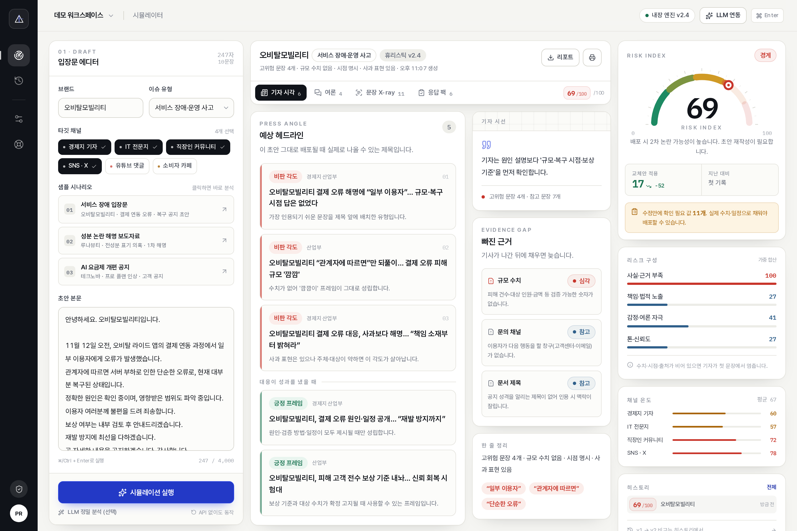

위기 커뮤니케이션은 “좋은 문장을 쓰는 일”이 아니라 **나가기 전에 어떤 질문을 맞을지 아는 일**입니다. PRISM은 초안을 문장 단위로 분해해 ① 기자가 쓸 제목과 취재 질문, ② 채널별 예상 여론, ③ 점수를 깎는 위험 구절과 교체안을 동시에 보여 줍니다. API 키 없이도 내장 엔진만으로 동작합니다.

---

## 1. 핵심 기능

| 영역 | 내용 |
| --- | --- |
| **3-패널 콘솔** | 초안 에디터 · 분석 탭 · 리스크 레일을 한 화면에. 모바일에서는 하단 내비게이션으로 전환 |
| **기자 시각** | 비판/긍정 프레임 헤드라인 5개, 날카로운 팩트체크 질문, 빠진 근거(수치·시점·사과 주체·검증·문의·제목) 점검 |
| **채널 여론** | 경제지·IT 전문지·직장인 커뮤니티·SNS/X·유튜브·소비자 카페 6개 채널의 예상 부정 톤, 확산 볼륨, 밈 리스크, 실제 반응 카드 |
| **리스크 & 문장 X-ray** | 0~100 리스크 게이지, 4개 축(근거·책임·감정·톤) 분해, 초안 안에 인라인 하이라이트된 위험 구절과 `-7점` 교체안 |
| **응답 팩** | 예상 Q&A 6문항(확인 필요 값 표시), 수정 1차안 자동 작성, 편집기로 되돌리기 |
| **히스토리** | localStorage 자동 저장, 두 버전을 골라 리스크 지수·축별 점수·채널 톤 변화 비교 |
| **내보내기** | 정돈된 Markdown 리포트 다운로드, 인쇄용 리포트(브라우저 인쇄 → PDF) |
| **LLM 연동(선택)** | OpenAI 호환 / Anthropic 키를 넣으면 헤드라인·취재 질문을 LLM이 보강. 실패해도 내장 엔진 결과 유지 |

### ① 기자가 쓸 제목과 질문


- 초안의 실제 문구를 인용한 비판 헤드라인 3개 + 대응이 성과를 냈을 때 성립하는 긍정 프레임 2개
- “최초 인지 시각과 공지까지 걸린 시간은?”처럼 **첫 질문에서 답이 없으면 기사가 되는** 항목을 우선 배치
- 수치·시점·사과 주체·검증 근거·문의 채널·문서 제목을 자동 점검해 빠진 것을 표시

### ② 채널별 여론과 바이럴 리스크

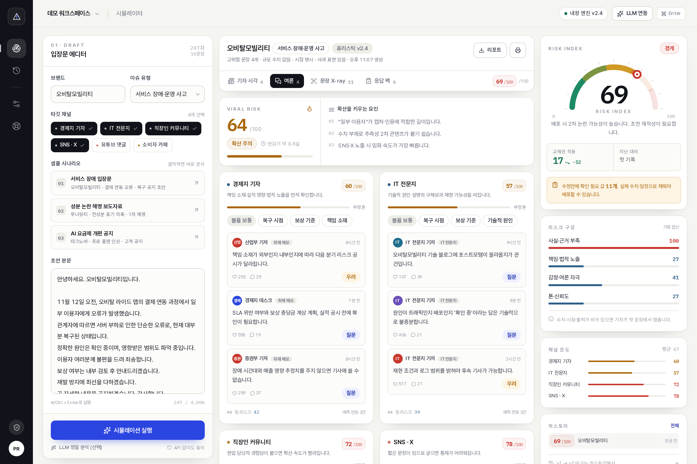

- 채널마다 부정 톤(0~100), 확산 볼륨, 밈 리스크, 주요 쟁점 태그
- 직장인 커뮤니티·SNS·유튜브·소비자 카페의 말투를 구분한 예상 반응 카드(좋아요·답글 수 포함)
- 바이럴 리스크와 예상 확산 반감기, 확산을 키우는 요인 3~4개

### ③ 리스크 게이지와 문장 X-ray

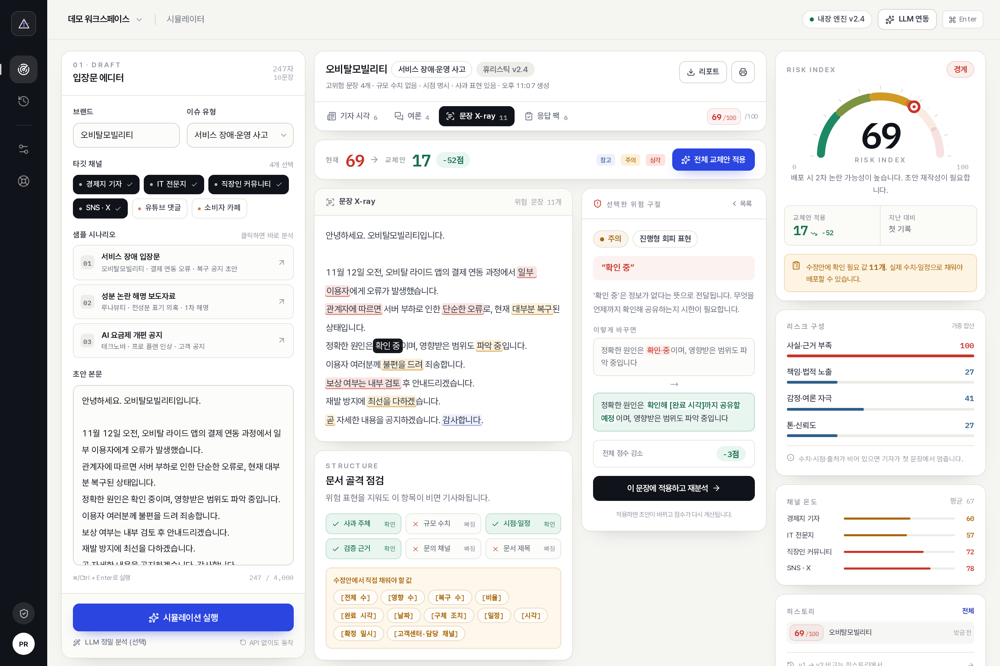

- 초안 속 위험 구절을 **문장 안에서 바로 하이라이트**. 클릭하면 사유와 교체 미리보기, 실제 점수 감소분(`-7점`) 표시
- “이 문장에 적용하고 재분석” → 초안이 바뀌고 점수가 다시 계산됩니다
- “전체 교체안 적용” 한 번으로 69점 → 17점까지 내려가는 것을 확인

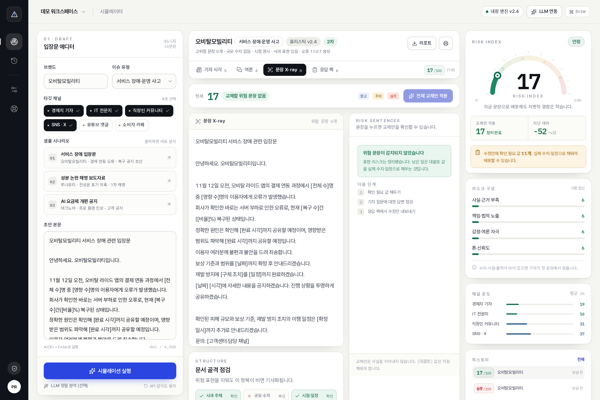

### ④ 응답 팩과 내보내기

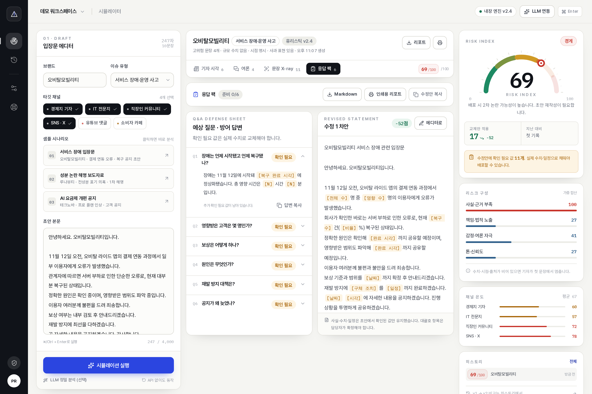

- 예상 질문 6개에 대한 방어 답변 초안. 근거가 없는 값은 `[확인 필요]`로 남겨 **지어내지 않습니다**
- 수정 1차안: 사과 → 확인된 사실 → 조치 → 일정 → 문의 순으로 재구성
- Markdown 다운로드 / 인쇄용 리포트 / 클립보드 복사

### ⑤ 버전 비교 히스토리

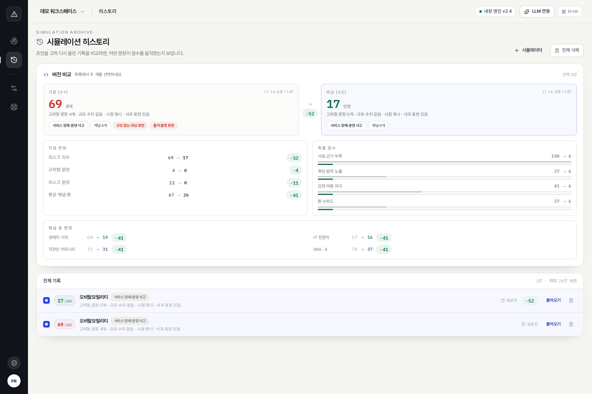

- 초안을 고쳐 다시 돌리면 자동 저장(localStorage, 최대 24건)
- 두 기록을 선택하면 리스크 지수, 고위험 문장 수, 리스크 문장 수, 평균 채널 톤, 축별 점수를 나란히 비교
- 69점(경계) → 17점(안정), 채널 평균 톤 67 → 26처럼 **무엇이 점수를 움직였는지** 확인

### ⑥ 인쇄용 리포트

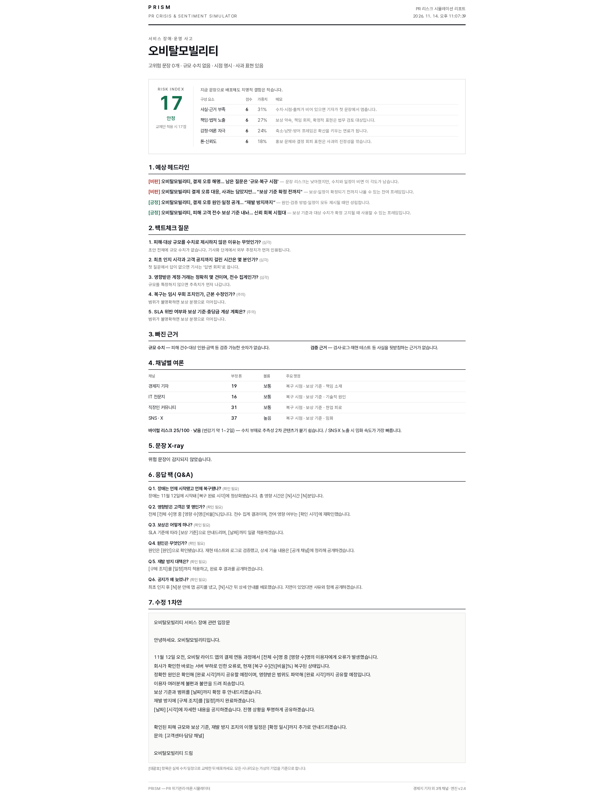

브라우저 인쇄(Ctrl/Cmd+P)로 리스크 요약·헤드라인·팩트체크·채널·X-ray·Q&A·수정안을 한 문서로 출력합니다.

### ⑦ 모바일

| 초안 | 분석 | 리스크 | X-ray |
| --- | --- | --- | --- |
| 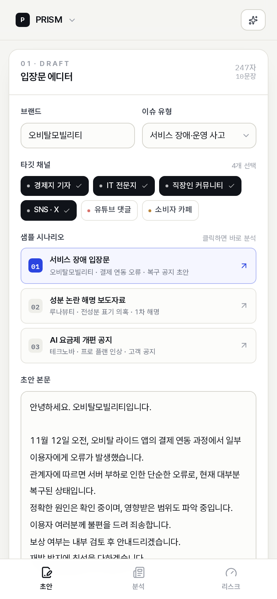 | 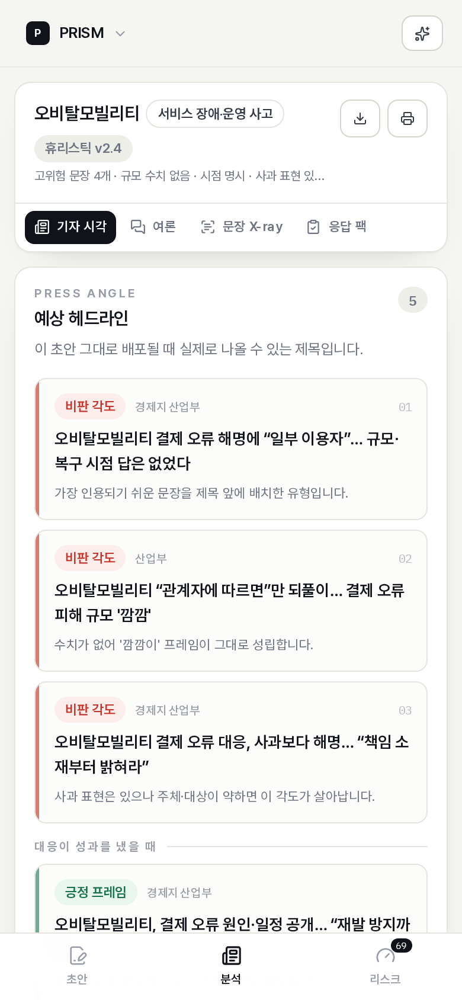 | 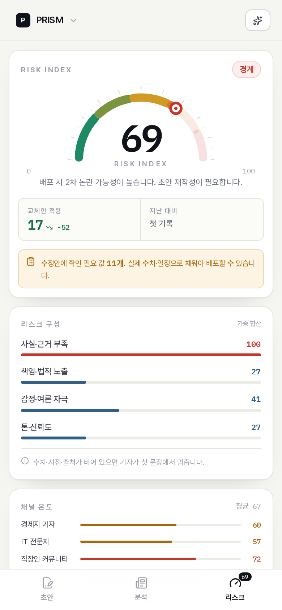 | 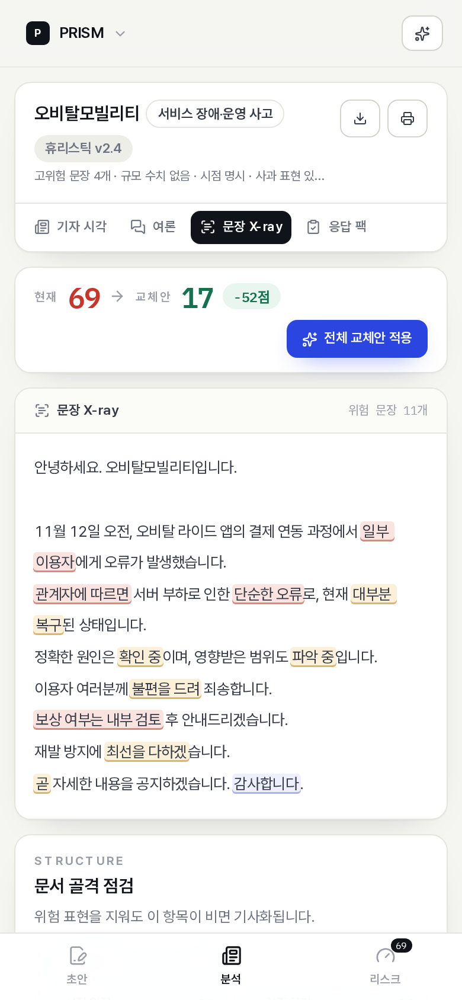 |

390px 폭에서 하단 내비게이션으로 초안·분석·리스크를 전환합니다. 1024px 태블릿에서는 에디터와 분석이 2단으로 붙고, 1280px 이상에서 3-패널 레일이 열립니다([태블릿 화면](docs/screenshots/14-tablet.png)).

---

## 2. 실행

```bash
npm install
npm run dev        # http://localhost:5182
npm run build      # tsc --noEmit + vite build
npm run preview    # http://localhost:4182
```

Node 20+ / Vite 7 / React 19 / TypeScript / Tailwind CSS v4. 외부 API·서버·DB가 없습니다.

### 샘플 시나리오 (모두 가상 기업)

| # | 브랜드 | 이슈 | 초안 성격 |
| --- | --- | --- | --- |
| 01 | 오비탈모빌리티 | 서비스 장애 | 결제 연동 오류 복구 공지 — “확인 중”·“일부 이용자”가 반복되는 전형적 초안 |
| 02 | 루나뷰티 | 제품 안전·성분 | 전성분 표기 의혹 해명 — “과도한 우려”, “업계 최고”가 섞인 방어적 보도자료 |
| 03 | 테크노바 | 요금·정책 변경 | AI 요금제 인상 공지 — “별도 안내 없이”, “위약금”이 들어간 법적 리스크 초안 |

샘플은 클릭 한 번으로 입력·분석까지 실행됩니다. 브랜드명과 초안은 직접 수정할 수 있습니다.

---

## 3. 리스크 엔진은 어떻게 점수를 내나

룰 + 휴리스틱 기반이며, **초안에 없는 사실을 만들지 않는 것**을 원칙으로 합니다.

1. **문장 분해** — 줄바꿈·마침표 기준으로 문장 경계를 잡고, 각 위험 구절의 위치를 원문 오프셋으로 유지합니다.
2. **위험 구절 탐지** — 30개 규칙(출처 불명, 축소 표현, 보상 약속, 사전 고지 누락, 불가피성 강조, 홍보 문체 등)을 문장에 적용하고, 겹치는 매치는 심각도가 높은 것만 남깁니다.
3. **4개 축 점수** — 근거 부족(31%) · 책임·법적 노출(27%) · 감정·여론 자극(24%) · 톤·신뢰도(18%)를 가중 합산.
4. **구조 보정** — 사과 주체·규모 수치·시점·문의 채널·검증 근거·문서 제목의 유무, 이슈 유형의 기본 위험도, 선택한 채널의 확산 성향을 가감합니다.
5. **교체 델타** — 각 교체안을 실제로 적용한 텍스트를 다시 채점해 `-N점`을 계산합니다(추정치가 아님).

| 점수 | 등급 | 의미 |
| --- | --- | --- |
| 0–24 | 안정 | 지금 문장으로 배포해도 치명적 결함은 적음 |
| 25–44 | 관찰 | 질문 몇 개로 흔들릴 수 있음 |
| 45–64 | 주의 | 비판 헤드라인이 성립 |
| 65–84 | 경계 | 2차 논란 가능성 높음, 재작성 필요 |
| 85–100 | 위험 | 사과가 아니라 방어로 읽힘 |

> 점수는 절대적 진단이 아니라 **초안 간 상대 비교와 개선 방향**을 위한 지표입니다. 실제 법률·언론 대응 전에는 담당자 검토가 필요합니다.

### LLM 정밀 분석(선택)

우측 상단 **LLM 연동**에서 OpenAI 호환 또는 Anthropic 키를 넣으면, 내장 엔진 결과에 LLM이 만든 헤드라인과 취재 질문을 더합니다.

- 키는 브라우저 로컬 저장소에만 보관되고 서버로 전송되지 않습니다.
- 브라우저에서 제공자 API를 직접 호출하므로 **CORS 정책에 따라 실패할 수 있습니다.** 실패 시 토스트로 알리고 내장 엔진 결과를 그대로 보여 줍니다.
- ‘연결 확인’ 버튼으로 키·모델을 먼저 점검할 수 있습니다.

---

## 4. 데이터와 프라이버시

- 서버가 없습니다. 초안·분석 기록·API 키는 모두 브라우저 localStorage에만 저장됩니다.
- 히스토리는 최대 24건, 앱에서 즉시 삭제할 수 있습니다.
- 등장하는 기업·제품·인물·반응은 전부 가상이며, 실제 회사나 개인 정보를 사용하지 않습니다.
- 분석 결과의 `[대괄호]` 값은 실제 수치·일정으로 교체해야 하는 자리입니다.

---

## 5. 프로젝트 구조

```
src/
├─ App.tsx                  # 3-패널 레이아웃, 실행/적용/히스토리 상태
├─ types.ts                 # Analysis·RiskSpan·RunRecord 등 도메인 타입
├─ components/
│  ├─ Sidebar · TopBar      # 내비게이션과 엔진 상태
│  ├─ InputPanel            # 브랜드·이슈·채널·샘플·에디터
│  ├─ RiskGauge             # 세그먼트 게이지(현재 점수까지 정확히 채움)
│  ├─ RiskRail              # 점수·축별 구성·채널 온도·최근 기록
│  ├─ HistoryView           # 버전 비교와 기록 관리
│  ├─ ApiModal · EmptyState · PrintReport
│  └─ tabs/                 # PressTab · SentimentTab · XrayTab · ResponseTab
└─ lib/
   ├─ presets.ts            # 이슈·채널 정의, 가상 샘플 3종
   ├─ rules.ts              # 30개 위험 규칙과 문구 단위 교체안
   ├─ engine.ts             # 문장 분해·탐지·채점·헤드라인·여론·Q&A 생성
   ├─ sentiment.ts          # 채널별 예상 반응 코퍼스
   ├─ korean.ts             # 은/는·이/가·을/를·로/으로 조사 처리
   ├─ llm.ts                # 선택적 LLM 보강(브라우저 직접 호출)
   ├─ report.ts             # Markdown 리포트 생성
   └─ storage.ts            # localStorage 히스토리·설정
```

---

## 6. 검증

| 항목 | 결과 |
| --- | --- |
| `npx tsc --noEmit` | 오류 0 |
| `npm run build` | 성공 (JS 371.7 kB / gzip 113.8 kB, CSS 46.0 kB / gzip 9.2 kB) |
| Playwright Chromium (1440×960, 1024×820, 390×844) | 콘솔 오류·페이지 오류 0 |
| 기능 시나리오 | 분석 실행, 수정 감지·재분석, 문장 교체 적용, Markdown 다운로드, 히스토리 비교·삭제, 모바일 패널 전환 모두 통과 |
| 레이아웃 | 1440/1024/390px에서 가로 스크롤 없음 |

스크린샷은 `docs/screenshots/`에 있으며, `scripts/shots.py`·`scripts/verify.py`로 재생성·재검증할 수 있습니다(Playwright 필요).

---

## 7. 알려진 한계

- 내장 엔진은 규칙 기반이라 문맥을 완전히 이해하지는 못합니다. 교체안은 **초안**이며, 숫자·일정은 반드시 담당자가 확정해야 합니다.
- LLM 보강은 브라우저 직접 호출이라 제공자 CORS 설정에 영향을 받습니다.
- 인쇄 리포트는 브라우저 인쇄 미리보기 기준으로 최적화되어 있습니다(Chromium/Safari 권장).
- 히스토리는 브라우저에 종속됩니다. 다른 기기와 동기화되지 않습니다.

---

PRISM — PR Intelligence Console · 데모용 가상 시나리오로 제작되었습니다.
