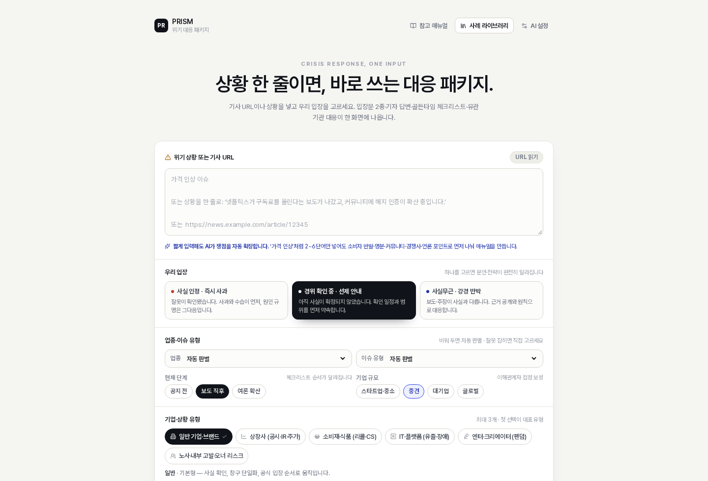

# PRISM — 위기 한 줄이면, 바로 쓰는 대응 패키지

> **상황 한 줄(‘가격 인상’처럼 짧은 키워드도) 또는 기사 URL을 넣고 우리 입장을 고르면, 오늘 바로 실행·복붙할 수 있는 위기 대응 패키지가 한 화면에 나옵니다.**
> 골든타임 체크리스트 · 고객 공지/언론 배포 입장문 2종 · 압박 질문과 답변 스크립트 · 유관기관 대응 · 악화 시 다음 대응까지.
> 상장사(공시·IR·주가), 소비재·식품(리콜·식약처), IT·플랫폼(개인정보·장애), 엔터·크리에이터, 노사·내부고발·오너 리스크, **가격·요금 인상** —
> **상황 유형을 고르면 각 섹션이 그 유형의 절차·법령·이해관계자로 다시 써집니다.**



기존 PRISM은 “내 초안을 진단하는 콘솔”이었습니다. 현장에서 필요한 건 진단이 아니라 **지금 무엇을 하고, 무엇을 올리고, 뭐라고 답할지**입니다.
그래서 입력을 하나로 줄이고(상황/URL + 입장 + 유형), 출력을 실행 순서대로 다시 세웠습니다.

- AI가 연결되면 서버가 **기사 본문을 직접 읽고** Gemini로 패키지를 씁니다. 연결되지 않아도 **매뉴얼 엔진**이 같은 구조의 패키지를 즉시 만듭니다.
- 확인되지 않은 사실은 만들지 않습니다. 필요한 값은 `[확인 필요: 항목]`으로 남기고, 그 개수를 화면에 표시합니다.

---

## 1. 입력 — 첫 화면은 카드 하나

| 항목 | 내용 |
| --- | --- |
| **위기 상황 또는 기사 URL** | 한 줄 설명. **4자 이상이면 ‘가격 인상’ 같은 키워드만으로도 분석**하며, 짧은 입력은 소비자 반발·명분·커뮤니티·경쟁사·언론 포인트 5축으로 쟁점을 먼저 확장합니다. `http(s)://…`가 들어 있으면 `/api/analyze`가 서버에서 HTML을 받아 title·meta description·본문을 추출해 프롬프트에 넣습니다. |
| **현재 단계** | `공지 전` / `보도 직후` / `여론 확산` — 1시간 체크리스트의 선행 항목과 진단 문장이 달라집니다. |
| **기업 규모** | `스타트업·중소` / `중견` / `대기업` / `글로벌` — 대표 직접 설명, 계열사 동일 문안, 현지 규제 확인 등 이해관계자 접점을 보정합니다. |
| **우리 입장 (1탭)** | `사실 인정·즉시 사과` / `경위 확인 중·선제 안내` / `사실무근·강경 반박` — 입장에 따라 사과 여부, 확인 일정, 반박 근거, 금기 표현이 전부 달라집니다. |
| **기업·상황 유형 (최대 3개)** | `일반 기업·브랜드` · `상장사(공시·IR·주가)` · `소비재·식품(리콜·CS)` · `IT·플랫폼(유출·장애)` · `엔터·크리에이터(팬덤)` · `노사·내부고발·오너 리스크`. 첫 선택이 대표, 나머지는 보강 레이어로 모든 섹션에 합쳐집니다. |
| **선택 입력** | 브랜드명(비우면 “당사”), `.txt/.md` 첨부, 기존 입장문 검수 모드 |

---

## 2. 출력 — 쟁점 확장 → 전체 시스템 → 실행 순서 7블록

0. **00 쟁점 확장 (Issue brief)** — 이 유형에서 먼저 잡아야 할 쟁점 5~7개, 숫자로 채워야 할 항목, 언론이 파고들 지점, 입력에 없어 가정한 부분을 한 카드에 모았습니다. 짧은 입력에서도 ‘무엇을 문제로 보고 있는지’ 먼저 확인할 수 있습니다.
1. **전체 대응 시스템 (Overview)** — `① 1시간 현황 파악·임시 대응` → `② 6시간 공식 입장·유관기관/언론` → `③ 24시간~ 수습·재발방지`.
   각 단계에 **목표(goal)** 와 **다음 단계로 넘어가기 위한 통과 기준(gate)** 을 붙였고, 아래에 “동시에 움직일 곳”을 칩으로 모았습니다.
2. **01 지금 당장 할 일** — 1시간/6시간/24시간 체크리스트. 항목마다 담당(공시·법무·CS·보안·노무…) 표시, 화면에서 체크하며 진행률을 볼 수 있습니다.
3. **02 바로 올릴 공식 입장문 2종** — ① 고객·커뮤니티 공지 ② 언론 배포·기자 회신. 유형별 법적 문구(공시 절차, 개인정보보호법 제34조 72시간 신고, 식품위생법 자진회수, 산업안전보건법 제54조 즉시 보고 등)가 본문에 들어갑니다. 블록별·편별 원클릭 복사.
4. **03 압박 질문 & 답변 스크립트** — 유형·입장에 특화된 질문 5~6개, 그대로 읽는 답변, 답변 요령, 피할 말. 아래에 **절대 쓰면 안 되는 금기 표현**과 이유.
5. **04 유관기관·이해관계자 대응** — 거래소 공시팀, 금감원, 개인정보보호위원회/KISA, 식약처, 고용노동부, 노조, 팬덤, 광고주… 누구에게 **언제 무엇을** 말하고, **첫 문장**은 무엇으로 시작할지.
6. **05 예상 여론 & 악화 시 다음 대응** — 채널별 예상 반응, 악화 트리거, 악화됐을 때 실행 순서.

**기존 입장문 검수 모드**는 별도 토글입니다. 위험 표현을 초안에서 그대로 인용해 이유와 교체 문장을 주고, 배포 가능한 리라이트를 만듭니다.

---

## 3. 유형별로 실제로 달라지는 것

| 유형 | 1시간 첫 항목 | 입장문에 반드시 들어가는 것 | 유관기관 |
| --- | --- | --- | --- |
| **일반 기업** | 상황실 소집·의사결정자 1명, 사실 3단 분류표 | 사과/조치/일정/문의처 | 주무부처·지자체 |
| **상장사** | 공시팀·IR·법무 소집, **조회공시 요구 여부** 판단, 임직원 블랙아웃 | 자본시장법·거래소 공시 절차, “확정 전 재무 영향 추정 금지” | 거래소, 금융위·금감원, 주주·기관, 애널리스트 |
| **소비재·식품** | 전 채널 판매 중지, 로트·유통기한 확인 | 자진회수(식품위생법 §45), 검사기관·항목·공개 일시, 환불 절차 | 식약처·지자체, 검사기관, 급식·가공처 |
| **IT·플랫폼** | 침해 경로 차단, 세션·토큰 무효화, 영향 범위 확인 | 개인정보보호법 §34 통지·**72시간 내 신고**(1,000명 이상·민감정보), 비밀번호 재설정 | 개인정보보호위원회, KISA, 제휴·결제사 |
| **엔터·크리에이터** | 당사자 사실 확인, 2차 가해 차단, 공식 채널 정리 | 확인 전 단정 금지, 활동·계약 일정, 명예훼손 대응 방침 | 팬덤, 광고주·방송사, 법무 |
| **노사·내부고발** | 중대재해 즉시 보고(산업안전보건법 §54), 증거 보전, 고발자 보호 | 보복 금지·신원 보호, 노동청 조사 협조, 교섭 일정 | 고용노동부, 노조, 이사회·감사 |
| **가격·요금 인상** | 인상 시점·폭·적용 대상·기존 고객 적용일 4개 숫자 표, 원가·투자 명분 수치 | 인상 시점·폭, 기존 고객 유예·동결, 해지·환불·위약금, 경쟁사·대안 비교 | 공정위·방통위·소비자원, 가입자, 언론(산업부·소비자부), 거래처·입점사, 임직원·CS |

유형을 여러 개 고르면 대표 유형의 절차 위에 보조 유형의 항목이 합쳐집니다(예: 상장사 + IT·플랫폼 → 공시 절차와 72시간 신고·개별 통지가 동시에).

---

## 4. 백엔드 (`api/analyze.ts`)

```
POST /api/analyze
{
  "mode": "package" | "review",
  "situation": "위기 상황 한 줄 또는 기사 URL",
  "stance": "apology" | "investigating" | "rebuttal",
  "brand": "브랜드명(선택)",
  "entities": ["listed", "platform"],
  "caseType": "pricing",
  "stage": "planned" | "breaking" | "spreading",
  "scale": "small" | "mid" | "large" | "global",
  "draft": "review 모드에서 검수할 입장문",
  "context": { "industryLabel": "...", "playbook": "...", "entityDigest": "...", "protocolDigest": "..." }
}
```

- **기사 읽기**: `situation`의 첫 URL을 서버가 직접 fetch(12초 제한, 1.8MB 상한). `<title>`·`og:description`·`<article>`/`<main>` 문단을 뽑아 최대 6,000자를 프롬프트에 넣습니다. `127.*`·`10.*`·`192.168.*` 등 사설망은 차단(SSRF), 검증 하네스에서만 `PRISM_ALLOW_LOCAL_FETCH=1`로 허용합니다.
- **모델**: `GEMINI_API_KEY` 우선(기본 `gemini-3.5-flash-lite`, `AQ.` 키 포함), 없으면 `OPENAI_API_KEY`(`gpt-4o-mini`). 서버 키가 없을 때만 요청의 개인 키를 프록시로 사용하며, 키 값은 응답에 내려보내지 않습니다.
- **타임아웃**: 기사 12초 + 모델 응답 총 55초. `vercel.json`의 `maxDuration` 60초 유지.
- **응답**: `{ ok, provider, model, latencyMs, usage, source: {url,title,chars,ok,note}, result }`
- **오류**: `input_too_short`(400) · `input_too_long`(413) · `fetch_failed`(422, URL만 넣었고 본문을 못 읽은 경우) · `no_key`(501) · `upstream_error`(502) · `timeout`(504)

---

## 5. 실행과 배포

```bash
npm install
npm run dev          # 로컬 개발 (Vite)
npm run build        # tsc --noEmit && vite build
npm run preview
```

Vercel: `npm run build`로 `dist`를 만들고 `api/analyze.ts`를 서버리스 함수로 배포합니다(`vercel.json`). 환경변수에 `GEMINI_API_KEY`(권장) 또는 `OPENAI_API_KEY`를 넣으면 기사 읽기와 실시간 생성이 켜집니다. 키가 없으면 매뉴얼 엔진 모드로 동작합니다.

GitHub Pages처럼 API가 없는 정적 호스팅에서도 화면은 그대로 동작합니다(매뉴얼 엔진 + “정적 배포” 안내).

---

## 6. 검증

```bash
export PATH=/workspace/.tools/node-v22.12.0-linux-x64/bin:$PATH
npm run build
python3 scripts/verify_package.py
```

`scripts/verify_package.py`가 실제 핸들러 번들 + 모의 Gemini/OpenAI/기사 서버를 띄워 **102개 항목**을 확인합니다.

- API 계약: 스키마(로드맵 3·액션 3·입장문 2·Q&A 5·금기 5), JSON 모드·temperature·출력 한도, 입장별 결과 차이, 유형(상장사) 지침 반영
- 기사 URL: 서버 fetch → title·본문 추출 → 프롬프트 반영, 본문 부족 시 422, 사설망 차단, 읽기 실패 시 설명으로 계속
- 검수 모드: 점수·지적·리라이트, 400/413/501/502 오류, 개인 키(AQ./sk-) 제공자 라우팅
- Gemini 503/429: 짧은 백오프로 1회만 재시도하고, 지속되면 502와 '자동 재시도' 안내
- 분류: '항공사 반려동물 사고'가 철강·중대재해로 가지 않고 유통·물류 + 제품 안전으로 잡히는지
- 직접 선택: 업종·이슈 유형을 고르면 그 기준으로 06·07이 계산되고, 선택값이 AI 프롬프트에 전달되는지
- 직접 등록 사례: CaseStudio에 저장한 사례 제목·교훈이 `/api/analyze` 프롬프트의 [유사 사례]에 들어가는지
- 전 16개 이슈 유형: 06(유사 사례 또는 표준 프로토콜)·07(대응 순서) 블록이 모두 표시되는지
- **‘가격 인상 이슈’ 단독 입력**: 자동으로 가격·요금 인상 유형을 잡고, 00 쟁점 확장·인상 숫자 체크리스트·기존 고객/해지 안내 문안이 나오며, 06에 산업재해·연예 등 무관 사례가 0건인지
- Markdown 복사: 팀 공유용 `# …` 문서와 골든타임 체크리스트 표가 생성되는지
- UI(데스크톱·모바일 390px): 단일 입력 카드, 입장 3개·유형 6개·업종/이슈 유형 선택, 5블록+전체 시스템, 입장문/Q&A/전체 복사, 기사 URL 흐름, 실패 안내, 매뉴얼 모달(유형·업종·실제 사례), 설정 모달, 최근 패키지, 로컬 엔진의 입장·유형·보조 유형 반영, 중대재해 애도 문구, 검수 리라이트, 가로 넘침 0, 콘솔 오류 0

스크린샷은 `docs/screenshots/31~39`에 생성됩니다.

---

## 7. 데이터·한계

- 상황 유형 매뉴얼 6종(`src/lib/profiles.ts`), 업종 매뉴얼 8종(`src/lib/industries.ts`·`industries-extra.ts`), 실제 위기 사례 **62건**(`src/data/cases` 4개 JSON + `src/lib/cases.ts` 20건)을 내장했습니다. 16개 이슈 유형 모두 최소 3건씩 있으며, 가격·요금 인상 유형에는 쿠팡(2021·2024)·넷플릭스·티빙·유튜브·배달의민족 사례 6건을 새로 넣었습니다.
- 업종·이슈 유형은 입력 화면에서 직접 고를 수 있습니다(기본 '자동 판별'). 자동 분류는 가중치·최소 점수 방식(`src/lib/classify.ts`)이라 일반 명사 하나로 업종이 바뀌지 않습니다.
- 06·07 블록은 **같은 유형 + (같은 업종 또는 태그 키워드)** 조건을 넘는 사례만 씁니다. 조건을 못 넘으면 무관한 사례를 붙이지 않고 그 유형의 **표준 대응 프로토콜**(`src/lib/issue-protocols.ts`)을 보여 줍니다. 직접 등록 사례도 같은 기준으로 반영됩니다.
- 매뉴얼 엔진은 규칙·템플릿 기반이라 상황의 미묘한 맥락은 AI보다 약합니다. AI가 연결된 환경에서 가장 정교합니다. 다만 16개 이슈 유형 표준 프로토콜을 내장해, AI가 없어도 유형에 맞는 숫자·보호 조치·이해관계자 접점은 유지됩니다.
- `[확인 필요]` 값(수치·시각·연락처)은 반드시 담당자가 확인해야 합니다. 이 앱은 사실을 만들어내지 않는 것을 원칙으로 합니다.
- 법령·감독 기준은 개정됩니다. 배포 전 최신 기준과 사내 법무 검토를 전제로 합니다.
- 입력과 결과는 서버에 저장하지 않습니다. 최근 패키지는 브라우저 localStorage에만 남습니다(최대 8건).
- 샘플·모의 데이터에는 실제 인물 정보가 없습니다. 사례 라이브러리의 기업·사건은 공개 자료로 확인한 실제 사례입니다.

---

PRISM — Crisis Response Package · 확인되지 않은 사실은 만들지 않습니다.
